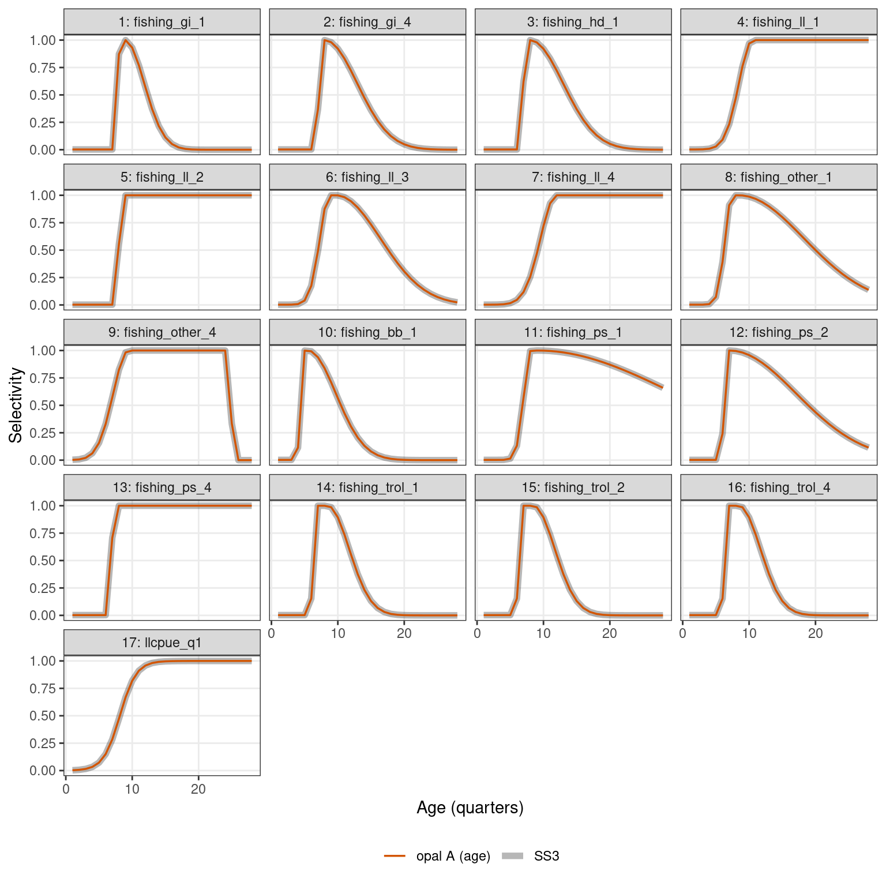
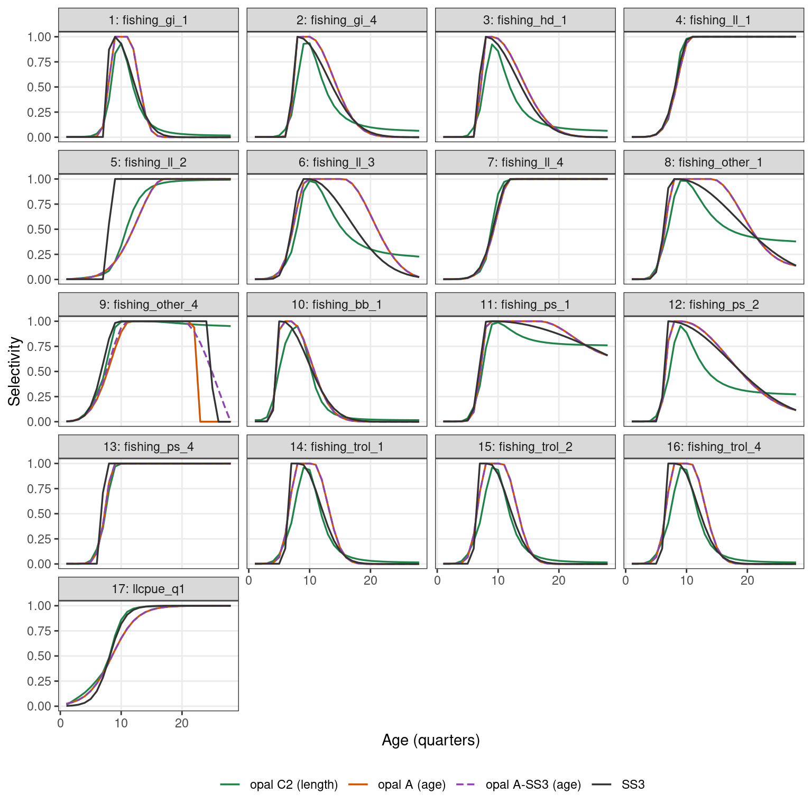
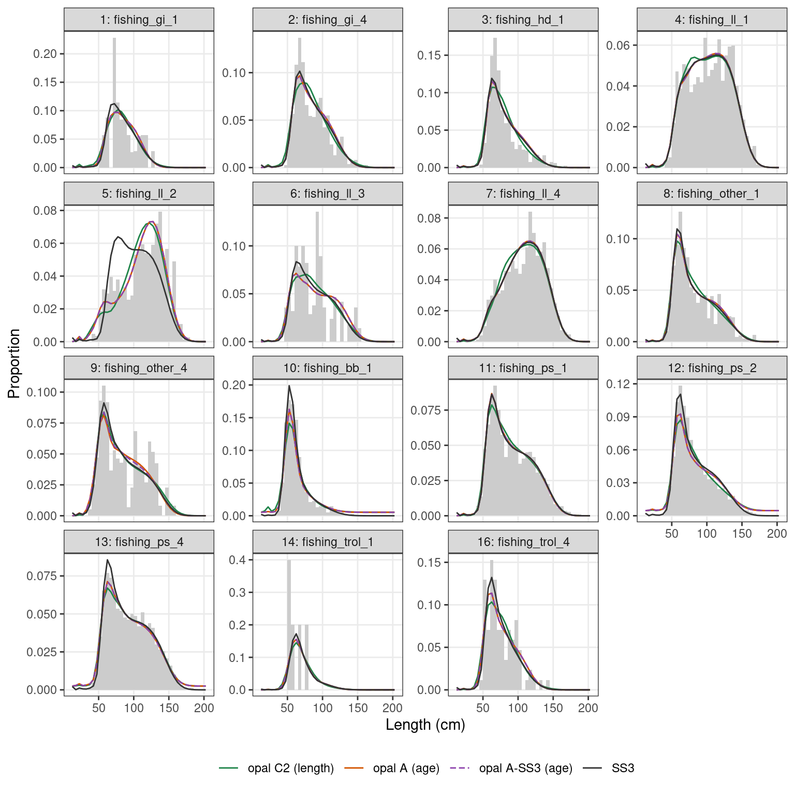
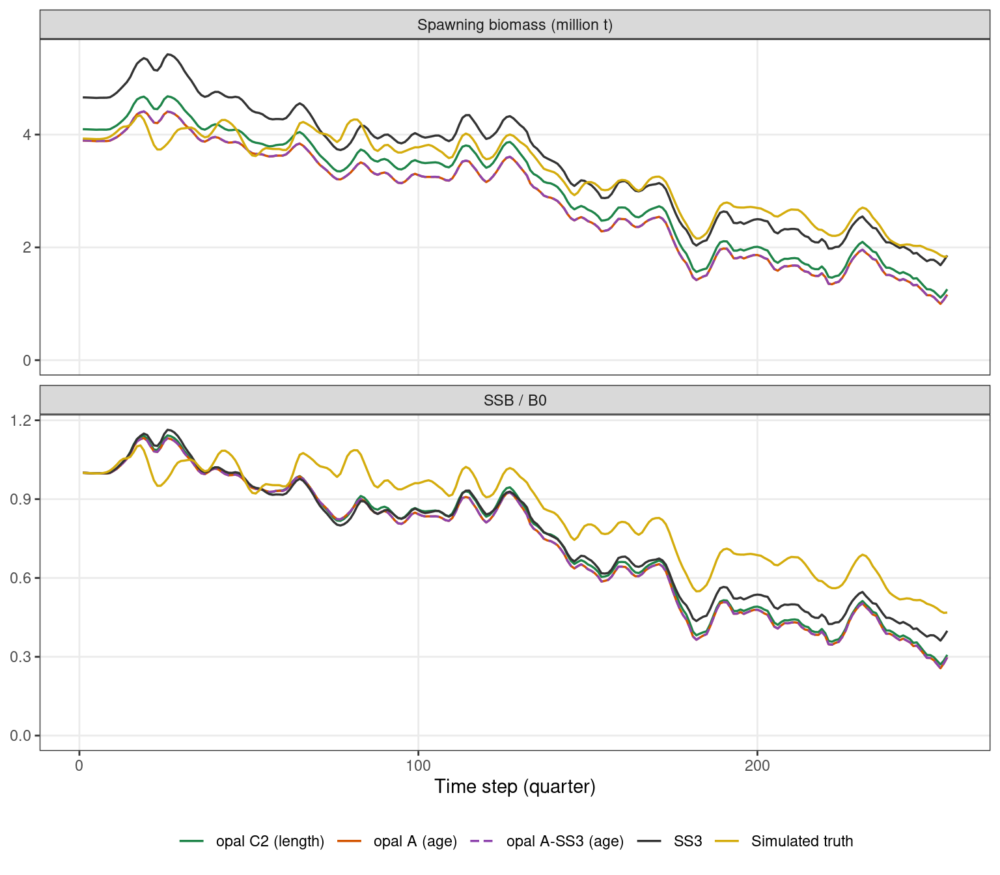

# Length- or age-based selectivity: Indian Ocean yellowfin

Setup

``` r

library(opal)
library(ggplot2)

data(io_yft_data)
data(io_yft_parameters)
data(io_yft_map)
data(io_yft_reference)

ref  <- io_yft_reference
d    <- io_yft_data
n_ts <- d$n_year

# Model outputs precomputed by data-raw/generate-io-yft-vignette-cache.R
cache <- readRDS(system.file("extdata", "io_yft_vignette_cache.rds", package = "opal"))
m <- cache$models

fmt <- function(x, digits = 2) formatC(x, format = "f", digits = digits, big.mark = ",")
options(knitr.kable.NA = "—")
fleet_name <- function(f) sprintf("%d: %s", as.integer(f), ref$fleet_names[as.integer(f)])
last <- function(df, v) df[[v]][df$ts == max(df$ts)]

series_col <- c("opal C2 (length)" = "#1E8449", "opal A (age)" = "#D35400",
                "opal A-SS3 (age)" = "#8E44AD", "SS3" = "grey20",
                "Simulated truth" = "#D4AC0D")
# A-SS3 is dashed so that A, drawn underneath, stays visible where they agree
series_lty <- setNames(rep("solid", length(series_col)), names(series_col))
series_lty[["opal A-SS3 (age)"]] <- "42"
scale_series <- list(scale_colour_manual(values = series_col, name = NULL, drop = TRUE),
                     scale_linetype_manual(values = series_lty, name = NULL, drop = TRUE))
theme_set(theme_bw(base_size = 11) +
            theme(legend.position = "bottom", panel.grid.minor = element_blank()))
```

opal evaluates its selectivity curves on length by default and maps them
to age through the distribution of length at age. Setting the data
element `sel_basis_f` to 2 for a fishery evaluates the same curve
families (logistic, double normal, double Richards) directly on age
instead. This article uses the simulated Indian Ocean yellowfin example
to show how to switch, and what the switch does to a real-sized
assessment. The data, the SS3 model and the length-based fit C2 are
described in
[`vignette("io-yft-ss3-comparison", package = "opal")`](https://n-ducharmebarth-noaa.github.io/opal/dev/articles/io-yft-ss3-comparison.md).

## Why it matters here

The SS3 model of these data uses **age-based** selectivity: double
normal curves (`age_selex` pattern 20) for the fisheries, mirrors
(pattern 15) for fisheries 15 and 16, and a logistic curve (pattern 12)
for the longline index. Fit C2 uses opal’s **length-based** curves,
seeded from SS3’s selectivity projected onto length. The bases differ in
the shape of selectivity-at-age: a length-based curve reaches age
through the spread of length at age, so it cannot bend as sharply as an
age-based one. In opal’s current composition likelihood, however, both
bases use the same length distribution within each age; larger fish of a
given age are not preferentially selected when predicting length
compositions.

Held at SS3’s selectivity, opal reproduces SS3’s stock size; C2 does
not:

Show code

``` r

h <- ref$history
knitr::kable(data.frame(h$model, B0_ratio = h$B0 / ref$ss3$ssb0, h$terminal_depletion),
             digits = c(0, 2, 3),
             col.names = c("opal fit", "B0 / SS3 B0", "Terminal SSB / B0"))
```

| opal fit | B0 / SS3 B0 | Terminal SSB / B0 |
|:---|---:|---:|
| opal, Schnute growth, SS3 selectivity | 0.77 | 0.267 |
| opal, SS3 age-specific K growth, SS3 selectivity | 1.03 | 0.404 |
| opal, SS3 age-specific K growth, opal selectivity (C2) | 0.88 | 0.307 |

SS3’s terminal SSB / B0 is 0.399. With age-based selectivity, opal can
estimate SS3’s own curves, which separates the effect of the selectivity
basis from everything else.

## Switching to age-based selectivity

### Basis and starting values

`sel_basis_f` takes one code per fishery (1 = length, 2 = age). Without
it, every fishery is length-based. Here every fishery switches:

Show code

``` r

d_age <- io_yft_data
d_age$sel_basis_f <- rep(2L, d_age$n_fishery)
```

Age-based curves take the same six `par_sel` columns as length-based
ones, centred and scaled by the ages rather than the length bins, so the
length-based starting values do not carry over. `io_yft_reference` holds
SS3’s estimated `age_selex` parameters, and
[`convert_ss3_selex_to_rtmb()`](https://n-ducharmebarth-noaa.github.io/opal/dev/reference/convert_ss3_selex_to_rtmb.md)
converts patterns 20 and 12 to opal’s double normal and logistic with
`basis = "age"`:

Show code

``` r

sp  <- ref$ss3$sel_par
pat <- ref$ss3$sel_pattern

# SS3 fleet whose parameters each opal fishery uses: fisheries 15 and 16
# mirror 14 (pattern 15), and the four quarterly index series 17-20 are
# SS3's survey, fleet 17.
ss3_fleet <- c(seq_len(16), rep(17L, 4))
mirror <- pat$pattern[ss3_fleet] == 15L
ss3_fleet[mirror] <- pat$special[ss3_fleet[mirror]]

ss3_pars <- t(vapply(ss3_fleet, function(fl) {
  v <- sp$value[sp$fleet == fl]
  c(v, rep(0, 6 - length(v)))
}, numeric(6)))

p_age <- io_yft_parameters
p_age$par_sel <- convert_ss3_selex_to_rtmb(ss3_pars, d_age$sel_type_f,
                                           sel_lengths = d_age$len_mid,
                                           basis = "age", sel_ages = d_age$age_a)
```

Show code

``` r

wide <- reshape(sp[sp$fleet %in% c(1:14, 17), c("fleet", "pattern", "par", "value")],
                idvar = c("fleet", "pattern"), timevar = "par", direction = "wide")
names(wide) <- c("fleet", "pattern", paste0("P", 1:6))
wide$fleet <- fleet_name(wide$fleet)
knitr::kable(wide, digits = 3, row.names = FALSE,
             caption = "SS3's age selectivity parameters (pattern 20: peak, top, ascending and descending width, initial and final selectivity; pattern 12: inflection and width).")
```

| fleet              | pattern |     P1 |      P2 |      P3 |     P4 |  P5 |   P6 |
|:-------------------|--------:|-------:|--------:|--------:|-------:|----:|-----:|
| 1: fishing_gi_1    |      20 |  7.894 | -10.354 |  -6.491 |  2.834 |  -6 | -999 |
| 2: fishing_gi_4    |      20 |  7.029 | -11.739 |  -9.353 |  3.864 |  -6 | -999 |
| 3: fishing_hd_1    |      20 |  6.975 | -12.757 |  -9.661 |  3.903 |  -6 | -999 |
| 4: fishing_ll_1    |      20 | 10.521 |   5.215 |   2.132 |  9.213 |  -6 | -999 |
| 5: fishing_ll_2    |      20 |  7.990 |   5.372 | -10.732 |  9.463 |  -6 | -999 |
| 6: fishing_ll_3    |      20 |  8.761 |  -9.740 |   1.465 |  4.482 |  -6 | -999 |
| 7: fishing_ll_4    |      20 | 11.926 |   5.112 |   2.419 |  9.035 |  -6 | -999 |
| 8: fishing_other_1 |      20 |  7.465 | -10.451 |   0.825 |  5.259 |  -6 | -999 |
| 9: fishing_other_4 |      20 |  9.430 |   1.533 |   2.357 | -2.204 |  -6 | -999 |
| 10: fishing_bb_1   |      20 |  4.496 |  -9.121 |  -2.189 |  3.571 |  -6 | -999 |
| 11: fishing_ps_1   |      20 |  8.109 |  -9.275 |   0.779 |  6.754 |  -6 | -999 |
| 12: fishing_ps_2   |      20 |  6.061 | -12.674 |  -8.027 |  5.309 |  -6 | -999 |
| 13: fishing_ps_4   |      20 |  6.954 |   5.495 |  -7.833 |  9.938 |  -6 | -999 |
| 14: fishing_trol_1 |      20 |  6.185 |  -2.714 |  -4.148 |  3.045 |  -6 | -999 |
| 17: llcpue_q1      |      12 |  8.137 |   3.628 |       — |      — |   — |    — |

SS3’s age selectivity parameters (pattern 20: peak, top, ascending and
descending width, initial and final selectivity; pattern 12: inflection
and width). {.table .caption-top}

SS3’s final selectivity is −999 for every double normal: “no
adjustment”, so the descending limb is the plain normal curve.
[`convert_ss3_selex_to_rtmb()`](https://n-ducharmebarth-noaa.github.io/opal/dev/reference/convert_ss3_selex_to_rtmb.md)
converts −999 to −9, which forces selectivity at the oldest age close to
zero and, through the rescaling of the descending limb, pulls the whole
limb down: by up to 0.6 for fishery 11 here. Both SS3 and opal rescale
the limb so that it ends at the final selectivity, so setting the final
selectivity to the unadjusted curve’s own value at the oldest age leaves
the limb unchanged, which reproduces “no adjustment” exactly:

Show code

``` r

# Unadjusted descending limb at the oldest age, as in sel_double_normal()
dn_unadjusted_end <- function(par, x) {
  n <- length(x)
  bin_width <- x[2] - x[1]
  peak <- mean(x) + par[1] * sd(x)
  peak2 <- peak + bin_width + (0.99 * x[n] - peak - bin_width) / (1 + exp(-par[2]))
  exp(-(x[n] - peak2)^2 / (exp(par[4]) * sd(x)^2))
}
for (f in which(d_age$sel_type_f == 2L & ss3_pars[, 6] <= -999)) {
  p_age$par_sel[f, 6] <- max(qlogis(dn_unadjusted_end(p_age$par_sel[f, ], d_age$age_a)), -20)
}
```

The final selectivity stays fixed when the other parameters are
estimated, so this is exact at the starting values and an approximation
once the peak or descending width move away from them.

### Bounds

opal bounds estimated selectivity parameters to ±7, which suits curves
centred and scaled on the length bins. On the age scale, SS3’s plateau
and ascending-width parameters for several fisheries are near −10 to −15
(SS3 bounds them at ±20).
[`get_bounds()`](https://n-ducharmebarth-noaa.github.io/opal/dev/reference/get_bounds.md)
needs only the names of the estimated parameters, so the default bounds
can be taken and widened for `par_sel`:

Show code

``` r

age_bounds <- function(parameters, map, lim = 20) {
  active <- unlist(lapply(names(parameters), function(n)
    rep(n, if (is.null(map[[n]])) length(parameters[[n]]) else nlevels(droplevels(map[[n]])))))
  b <- get_bounds(list(par = setNames(numeric(length(active)), active)), parameters)
  b$lower[b$parameter == "par_sel"] <- -lim
  b$upper[b$parameter == "par_sel"] <- lim
  b
}
```

### Check 1: the converted curves reproduce SS3’s

The age-based curves do not use the age–length key, so they can be
computed directly with
[`get_selectivity()`](https://n-ducharmebarth-noaa.github.io/opal/dev/reference/get_selectivity.md):

Show code

``` r

sel0 <- get_selectivity(d_age, p_age$par_sel, pla = NULL, len_mid = d_age$len_mid,
                        age_a = d_age$age_a)[, 1, ]
s0 <- data.frame(fishery = rep(seq_len(nrow(sel0)), times = ncol(sel0)),
                 age = rep(d_age$age_a, each = nrow(sel0)), sel = as.vector(sel0))
cmp <- merge(s0, ref$ss3$sel_age, by = c("fishery", "age"), suffixes = c("_opal", "_ss3"))
ggplot(cmp[cmp$fishery <= 17, ], aes(age)) +
  geom_line(aes(y = sel_ss3, colour = "SS3"), linewidth = 2, alpha = 0.35) +
  geom_line(aes(y = sel_opal, colour = "opal A (age)"), linewidth = 0.6) +
  facet_wrap(~ fishery, ncol = 4, labeller = as_labeller(fleet_name)) +
  scale_series +
  labs(x = "Age (quarters)", y = "Selectivity")
```



Selectivity-at-age: SS3’s, and opal’s age-based curves at the converted
SS3 parameters.

The largest difference over all fisheries and ages is 0.0010.

### Check 2: stock size at SS3’s parameters

With these curves and every other parameter at SS3’s solution, opal’s
stock trajectory should be the one it gives with SS3’s
selectivity-at-age supplied directly as a fixed matrix
(`sel_fa_external`). Neither run is fitted:

Show code

``` r

start <- opal_obj(d_age, p_age, io_yft_map, bounds = age_bounds(p_age, io_yft_map))

d_ext <- d_age
sa <- ref$ss3$sel_age
d_ext$sel_fa_external <- matrix(0, d_ext$n_fishery, d_ext$n_age)
d_ext$sel_fa_external[cbind(sa$fishery, match(sa$age, d_ext$age_a))] <- sa$sel
start_ext <- opal_obj(d_ext, p_age, io_yft_map, bounds = age_bounds(p_age, io_yft_map))

ssb_age <- opal_report(start)$spawning_biomass_y
ssb_ext <- opal_report(start_ext)$spawning_biomass_y
```

Show code

``` r

pct <- function(a, b) 100 * abs(a$ssb / b$ssb - 1)
ss3_traj <- ref$ss3$trajectory
knitr::kable(data.frame(
  comparison = c("Age-based curves vs SS3's fixed matrix",
                 "Age-based curves vs SS3", "SS3's fixed matrix vs SS3"),
  mean = c(mean(pct(m$A_start$trajectory, m$E_start$trajectory)),
           mean(pct(m$A_start$trajectory, ss3_traj)), mean(pct(m$E_start$trajectory, ss3_traj))),
  max = c(max(pct(m$A_start$trajectory, m$E_start$trajectory)),
          max(pct(m$A_start$trajectory, ss3_traj)), max(pct(m$E_start$trajectory, ss3_traj)))),
  digits = 3, col.names = c("Spawning biomass at SS3's parameters", "Mean |% diff|", "Max |% diff|"))
```

| Spawning biomass at SS3’s parameters   | Mean \|% diff\| | Max \|% diff\| |
|:---------------------------------------|----------------:|---------------:|
| Age-based curves vs SS3’s fixed matrix |           0.002 |          0.010 |
| Age-based curves vs SS3                |           2.540 |         10.267 |
| SS3’s fixed matrix vs SS3              |           2.543 |         10.279 |

The two opal runs agree to within 0.010%. Both differ from SS3 by up to
10%, which comes from when catch is removed within the quarter, not from
selectivity (see the comparison article).

## Fits

### What is estimated

Two age-based fits are compared with C2:

- **A** uses C2’s map exactly: `log_B0`, the recruitment deviations, the
  four catchabilities and the same 49 selectivity parameters. The basis
  is the only difference from C2.
- **A-SS3** estimates every selectivity parameter SS3 estimated (phase
  \> 0): P1–P4 of each double normal and both logistic parameters, with
  SS3’s mirrors. That adds the nine parameters C2 fixes because the
  length data do not inform them under length-based selectivity.

Show code

``` r

est <- matrix(NA_integer_, d_age$n_fishery, 6)
k <- 0L
for (fl in unique(ss3_fleet)) {
  cols <- sp$par[sp$fleet == fl & sp$phase > 0]
  ids <- k + seq_along(cols)
  k <- k + length(cols)
  for (f in which(ss3_fleet == fl)) est[f, cols] <- ids
}
map_ss3 <- io_yft_map
map_ss3$par_sel <- factor(as.vector(est))

c(C2_and_A = nlevels(io_yft_map$par_sel), A_SS3 = nlevels(map_ss3$par_sel))
#> C2_and_A    A_SS3 
#>       49       58
```

Each fit takes a few minutes, so the article reads stored results. The
fits were made from exactly these inputs;
`data-raw/generate-io-yft-age-fits.R` adds Newton steps and
[`opal_check()`](https://n-ducharmebarth-noaa.github.io/opal/dev/reference/opal_check.md),
as for C2.

Show code

``` r

fit_a     <- opal_fit(opal_obj(d_age, p_age, io_yft_map,
                               bounds = age_bounds(p_age, io_yft_map)), n_passes = 2L)
fit_a_ss3 <- opal_fit(opal_obj(d_age, p_age, map_ss3,
                               bounds = age_bounds(p_age, map_ss3)), n_passes = 2L)

# The stored fits
fit_a     <- opal_read(system.file("extdata", "io_yft_age_fit.rds", package = "opal"))
fit_a_ss3 <- opal_read(system.file("extdata", "io_yft_age_ss3_fit.rds", package = "opal"))
```

Show code

``` r

fits <- list("opal C2 (length)" = m$C2, "opal A (age)" = m$A, "opal A-SS3 (age)" = m$A_ss3)
fit_tab <- do.call(rbind, lapply(names(fits), function(nm) {
  x <- fits[[nm]]
  data.frame(model = nm, sel = x$sel_free, n_par = x$fit$n_par,
             objective = x$objective, t(x$nll),
             grad = formatC(x$fit$max_gradient, format = "e", digits = 1),
             check = if (isTRUE(x$fit$passes)) "passed" else "failed")
}))
knitr::kable(fit_tab[, c("model", "sel", "n_par", "objective", "index", "length",
                         "recruitment", "prior", "grad", "check")],
             digits = 2, row.names = FALSE,
             col.names = c("Model", "Selectivity parameters", "Estimated parameters",
                           "Objective", "Index", "Length comps", "Recruitment",
                           "Priors", "Max |gradient|", "opal_check()"))
```

| Model | Selectivity parameters | Estimated parameters | Objective | Index | Length comps | Recruitment | Priors | Max \|gradient\| | opal_check() |
|:---|---:|---:|---:|---:|---:|---:|---:|:---|:---|
| opal C2 (length) | 49 | 310 | 14406.58 | -240.26 | 14236.18 | 136.28 | 444.37 | 8.0e-12 | passed |
| opal A (age) | 49 | 310 | 14658.10 | -240.25 | 14220.59 | 136.91 | 711.41 | 1.2e-11 | passed |
| opal A-SS3 (age) | 58 | 319 | 14625.29 | -240.25 | 14220.55 | 136.91 | 678.66 | 1.2e-11 | passed |

All three fits converge and pass
[`opal_check()`](https://n-ducharmebarth-noaa.github.io/opal/dev/reference/opal_check.md).
The objectives are not comparable across the two bases, because of the
priors. opal puts an N(0, 2) prior on every element of `par_sel`, fixed
or estimated. The parameters are centred and scaled by the length bins
for C2 and by the ages for A, so the same prior is a different prior on
the curves. SS3’s plateau and ascending-width parameters are near −10 to
−15 on the age scale, so A’s prior term is 267 larger than C2’s: the
whole of the difference in objective and more.

The data terms compare directly. C2 and A fit the index equally well,
and A fits the length compositions better, by 15.6 likelihood units with
the same number of parameters. Estimating the nine extra parameters
(A-SS3) improves the length compositions by only 0.04; the lower
objective of A-SS3 comes from the prior, as those parameters move
towards its mean. As under length-based selectivity, the data do not
inform them.

## Selectivity

Show code

``` r

sa <- rbind(
  data.frame(ref$ss3$sel_age, series = "SS3"),
  do.call(rbind, lapply(names(fits), function(nm)
    data.frame(fits[[nm]]$sel_age, series = nm))))
sa$series <- factor(sa$series, names(series_col))
ggplot(sa[sa$fishery <= 17, ], aes(age, sel, colour = series, linetype = series)) +
  geom_line(linewidth = 0.6) +
  facet_wrap(~ fishery, ncol = 4, labeller = as_labeller(fleet_name)) +
  scale_series +
  labs(x = "Age (quarters)", y = "Selectivity")
```



Selectivity-at-age: SS3’s, C2’s length-based curves mapped to age, and
the age-based fits.

Fisheries 15 and 16 mirror 14, and panel 17 stands for all four
quarterly index series.

The age-based fits follow SS3’s ascending limbs closely, including the
sharp rises that C2’s length-based curves smooth out. Where they depart
from SS3, C2 departs in the same direction: fishery 5’s ascending limb
is much shallower than SS3’s, and fisheries 6, 8 and 11 keep selectivity
higher than SS3 at intermediate ages. A and A-SS3 differ only for
fishery 9. A holds its descending width at SS3’s value while its peak
moves, so its selectivity drops to zero within two quarters; A-SS3
estimates the width and gives a gradual decline. The length compositions
barely distinguish the two (0.04 likelihood units in total).

## Fits to the data

### Length compositions

Show code

``` r

obs <- do.call(rbind, lapply(seq_along(d$lf_fishery_f), function(j) {
  o <- d$lf_obs_data$obs[[j]]
  o <- o / rowSums(o)
  n <- d$lf_n_fi[[j]]
  data.frame(fishery = d$lf_fishery_f[j], bin = d$len_lower, observed = colSums(o * n) / sum(n))
}))
lines <- rbind(
  do.call(rbind, lapply(names(fits), function(nm)
    data.frame(fishery = fits[[nm]]$lf$fishery, bin = fits[[nm]]$lf$bin,
               value = fits[[nm]]$lf$predicted, series = nm))),
  data.frame(fishery = ref$ss3$lf$fishery, bin = ref$ss3$lf$bin,
             value = ref$ss3$lf$expected, series = "SS3"))
lines$series <- factor(lines$series, names(series_col))
width <- diff(d$len_lower[1:2])
ggplot() +
  geom_col(data = obs, aes(bin + width / 2, observed), fill = "grey80", width = width) +
  geom_line(data = lines, aes(bin + width / 2, value, colour = series, linetype = series),
            linewidth = 0.5) +
  facet_wrap(~ fishery, ncol = 4, scales = "free_y", labeller = as_labeller(fleet_name)) +
  scale_series +
  labs(x = "Length (cm)", y = "Proportion")
```



Length compositions aggregated over all observations for each fishery,
weighted by sample size: observed (bars) and each model’s predictions.

### Index

Show code

``` r

rmse <- function(o, p) sqrt(mean((log(o) - log(p))^2))
cp <- d$cpue_data
knitr::kable(data.frame(
  model = c(names(fits), "SS3"),
  rmse = c(vapply(fits, function(x) rmse(cp$value, x$cpue$pred), numeric(1), USE.NAMES = FALSE),
           rmse(ref$ss3$cpue$obs, ref$ss3$cpue$expected))),
  digits = 4, col.names = c("Model", "RMSE of log index residuals"))
```

| Model            | RMSE of log index residuals |
|:-----------------|----------------------------:|
| opal C2 (length) |                      0.0621 |
| opal A (age)     |                      0.0617 |
| opal A-SS3 (age) |                      0.0617 |
| SS3              |                      0.0646 |

## Stock status

Show code

``` r

traj <- rbind(
  do.call(rbind, lapply(names(fits), function(nm) data.frame(fits[[nm]]$trajectory, series = nm))),
  data.frame(ref$ss3$trajectory, series = "SS3"),
  data.frame(ref$truth$trajectory, series = "Simulated truth"))
traj$series <- factor(traj$series, names(series_col))
long <- rbind(data.frame(ts = traj$ts, series = traj$series, value = traj$ssb / 1e6,
                         panel = "Spawning biomass (million t)"),
              data.frame(ts = traj$ts, series = traj$series, value = traj$static_dep,
                         panel = "SSB / B0"))
ggplot(long, aes(ts, value, colour = series, linetype = series)) +
  geom_line(linewidth = 0.6) +
  facet_wrap(~ panel, ncol = 1, scales = "free_y") +
  expand_limits(y = 0) +
  scale_series +
  labs(x = "Time step (quarter)", y = NULL)
```



Spawning biomass (top) and static depletion SSB / B0 (bottom) of each
fit, SS3 and the simulated truth.

Show code

``` r

status <- data.frame(
  model = c(names(fits), "SS3", "Simulated truth"),
  B0 = c(vapply(fits, `[[`, numeric(1), "B0", USE.NAMES = FALSE), ref$ss3$ssb0, ref$truth$b0),
  dep = c(vapply(fits, function(x) last(x$trajectory, "static_dep"), numeric(1),
                 USE.NAMES = FALSE),
          last(ref$ss3$trajectory, "static_dep"), last(ref$truth$trajectory, "static_dep")))
status$B0_ss3 <- status$B0 / ref$ss3$ssb0
status$B0_truth <- status$B0 / ref$truth$b0
knitr::kable(status[, c("model", "B0_ss3", "B0_truth", "dep")], digits = 3, row.names = FALSE,
             col.names = c("Model", "B0 / SS3 B0", "B0 / true B0", "Terminal SSB / B0"))
```

| Model            | B0 / SS3 B0 | B0 / true B0 | Terminal SSB / B0 |
|:-----------------|------------:|-------------:|------------------:|
| opal C2 (length) |       0.879 |        1.042 |             0.307 |
| opal A (age)     |       0.836 |        0.991 |             0.298 |
| opal A-SS3 (age) |       0.836 |        0.992 |             0.298 |
| SS3              |       1.000 |        1.186 |             0.399 |
| Simulated truth  |       0.843 |        1.000 |             0.468 |

## Summary

- Switching a fishery to age-based selectivity takes one data element,
  `sel_basis_f = 2`, and starting values on the age scale, which
  `convert_ss3_selex_to_rtmb(basis = "age")` provides from SS3’s
  patterns 20 and 12. SS3’s −999 “no adjustment” final selectivity needs
  the extra step shown above, and SS3’s values need wider `par_sel`
  bounds than opal’s default.
- At SS3’s parameters, the converted curves reproduce SS3’s
  selectivity-at-age, and the stock trajectory is the one opal gives
  with SS3’s selectivity supplied as a fixed matrix.
- Estimated with C2’s map, the age-based fit A fits the length
  compositions better than the length-based C2, with B0 0.84 × SS3’s and
  terminal depletion 0.298, against 0.88 × and 0.307 for C2 and 0.399
  for SS3. Estimating every parameter SS3 estimated (A-SS3) changes
  neither.
- So the selectivity basis does not explain why opal’s estimated stock
  is smaller than SS3’s: with SS3’s curve families on SS3’s basis,
  estimated from the same data, opal moves no closer to SS3. Held at
  SS3’s estimates, the same curves give B0 1.03 × SS3’s. The remaining
  differences are in the rest of the model (catch timing within the
  quarter, the index and the priors; see the comparison article).
- The N(0, 2) selectivity prior is a stronger constraint on the age
  scale than on the length scale here. It is part of what differs
  between A and SS3, which has no prior on selectivity.

The outputs in this article were computed with opal 0.1.1 (commit
7ced786) by `data-raw/generate-io-yft-vignette-cache.R`.
