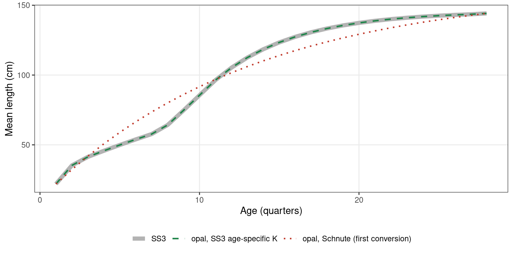

# Comparing opal with Stock Synthesis: Indian Ocean yellowfin

Setup

``` r

library(opal)
library(ggplot2)

data(io_yft_data)
data(io_yft_parameters)
data(io_yft_map)
data(io_yft_reference)

ref   <- io_yft_reference
d     <- io_yft_data
n_ts  <- d$n_year
truth <- ref$truth$trajectory
ss3   <- ref$ss3$trajectory

# Model outputs precomputed by data-raw/generate-io-yft-vignette-cache.R, so
# the article renders without rebuilding the RTMB model
cache <- readRDS(system.file("extdata", "io_yft_vignette_cache.rds", package = "opal"))
c2    <- cache$models$C2

fmt <- function(x, digits = 2) formatC(x, format = "f", digits = digits, big.mark = ",")
options(knitr.kable.NA = "—")
fleet_name <- function(f) sprintf("%d: %s", as.integer(f), ref$fleet_names[as.integer(f)])
last <- function(df, v) df[[v]][df$ts == max(df$ts)]

series_col <- c("opal C2" = "#1E8449", "SS3" = "grey20", "Simulated truth" = "#D4AC0D")
scale_series <- list(scale_colour_manual(values = series_col, name = NULL))
theme_set(theme_bw(base_size = 11) +
            theme(legend.position = "bottom", panel.grid.minor = element_blank()))
```

This vignette fits opal to a simulated Indian Ocean yellowfin tuna data
set and compares the result with the Stock Synthesis 3 (SS3) model built
for the same data, and with the simulated truth those data came from.
Everything it needs is bundled with the package: the opal inputs, a
stored fit, and summary tables from SS3 and from the operating model.

## Background

### The data and the SS3 model

The data are replicate 4 of the Indian Ocean yellowfin operating model
(OM) of the [Spatial Stock Assessment Simulation
Experiment](https://aaronmberger-nwfsc.github.io/Spatial-Assessment-Modeling-Workshop/articles/OM_description_YFT.html).
The OM was built in the Spatial Population Model software (SPM; Dunn,
Rasmussen and Mormede 2015) and conditioned on Indian Ocean Tuna
Commission (IOTC) fishery data (Dunn, Hoyle and Datta 2020). It is
spatially explicit:

- **Space and time.** The population lives on a 5° × 5° grid of 159
  ocean cells, in quarterly time steps from 1952 to 2015 (256 quarters),
  with ages 1–28 quarters (28 is a plus group).
- **Recruitment.** One stock with one Beverton–Holt stock–recruitment
  relationship (steepness 0.8) on the total spawning biomass. Quarterly
  recruitment strength varies (lognormal, SD 0.6), and each quarter’s
  recruits are spread across cells by a spatial apportionment layer with
  its own random variation.
- **Movement.** Fish move between cells every quarter according to
  habitat preferences for sea surface temperature, chlorophyll-a and
  distance, separately for immature and mature fish. Maturation moves
  fish from the immature to the mature state.
- **Fishing.** Seven gear-type fisheries remove their observed catches
  exactly, cell by cell, using exploitation rates.
- **Data.** Catch (without error), longline CPUE, length frequencies and
  tag recaptures are simulated cell by cell.

For the experiment, the simulated data were aggregated to the four
regions of the IOTC yellowfin assessment and to a single area. Because
the data are simulated, the true spawning biomass and unfished spawning
biomass (B0) are known. The truth files report them by assessment
region; here they are summed over the whole domain. Spawning biomass is
mature biomass at the start of the quarter, before fishing, in tonnes,
the same definition as SS3’s.

The SS3 model (SS3 v3.24) is the IATTC analyst team’s single-region
estimation model for that experiment, built by Mark N. Maunder, Haikun
Xu and Carolina Minte-Vera. It treats each quarter as a model “year”, so
it runs 256 time steps. opal takes the same time steps (`n_year =` 256,
`n_season = 1`) and SS3’s ages 1–28, so the opal age index equals the
SS3 age. Although the SS3 model is single-region, it keeps the
four-region structure in its fleets: its 16 extraction fisheries are
gear × region combinations from the four-region data (for example,
`fishing_ll_1` to `fishing_ll_4` are longline in regions 1–4). SS3’s
mean length-at-age is the OM’s own (Fu et al. 2018, after Fonteneau and
Gascuel 2008), so growth is known exactly.

Show code

``` r

knitr::kable(data.frame(
  quantity = c("Time steps (quarters)", "Ages", "Extraction fisheries",
               "Index series (longline CPUE, one per quarter)",
               "Fisheries with length compositions", "Length bins"),
  value = c(n_ts, d$n_age, 16, 4, length(d$lf_fishery_f), d$n_len)),
  col.names = c("Quantity", "Value"))
```

| Quantity                                      | Value |
|:----------------------------------------------|------:|
| Time steps (quarters)                         |   256 |
| Ages                                          |    28 |
| Extraction fisheries                          |    16 |
| Index series (longline CPUE, one per quarter) |     4 |
| Fisheries with length compositions            |    15 |
| Length bins                                   |    39 |

Catch is in numbers. The longline CPUE index is split into four
quarterly series, each with its own catchability (opal fisheries 17–20).
Length compositions enter as multinomials, with SS3’s variance
adjustments (`mult_by_lencomp_N`) carried across.

### Converting SS3 to opal

The opal inputs were produced by an SS3-to-opal converter
([wcpfc-bet-single-region](https://github.com/N-DucharmeBarth/wcpfc-bet-single-region),
`code/rtmb`). It reads the SS3 data, control, parameter and report
files, and its output reconciles exactly with SS3 for catch, the index,
the length compositions and biology (M, weight, maturity and spawning
potential at age). Fitted at SS3’s own parameter values, opal tracks
SS3’s spawning biomass to within 10%, and that gap comes entirely from
when catch is removed within the quarter (see [Model
differences](#model-differences)).

The first conversion used opal’s single-k Schnute growth curve. SS3 uses
its `GrowthModel 3`, where K changes with age, and the Schnute curve
cannot follow it: it was 5–16 cm too long at ages 4–8. Through the
length compositions, that shifted the fitted stock size well away from
SS3’s. opal now implements SS3’s age-specific K growth as an option to
[`get_growth()`](https://n-ducharmebarth-noaa.github.io/opal/dev/reference/get_growth.md)
(`log_k_mult` and `k_mult_ages`), and the bundled inputs use it with
SS3’s growth parameters.

Show code

``` r

p <- io_yft_parameters
laa_opal <- get_growth(d$n_age, d$A1, d$A2, exp(p$log_L1), exp(p$log_L2), p$log_k,
                       min_age = d$min_age, log_k_mult = p$log_k_mult,
                       k_mult_ages = d$k_mult_ages,
                       plus_group_adjust = isTRUE(d$growth_plus_group_adjust))
growth_lab <- c("SS3", "opal, SS3 age-specific K", "opal, Schnute (first conversion)")
growth <- rbind(
  data.frame(ref$ss3$length_at_age, series = growth_lab[1]),
  data.frame(age = d$age_a, length = laa_opal, series = growth_lab[2]),
  data.frame(ref$schnute_length_at_age, series = growth_lab[3]))
growth$series <- factor(growth$series, growth_lab)
# SS3 is drawn wide underneath so the identical opal curve stays visible.
ggplot(growth, aes(age, length, colour = series, linetype = series, linewidth = series)) +
  geom_line() +
  scale_colour_manual(values = setNames(c("grey70", "#1E8449", "#C0392B"), growth_lab),
                      name = NULL) +
  scale_linetype_manual(values = setNames(c("solid", "dashed", "dotted"), growth_lab),
                        name = NULL) +
  scale_linewidth_manual(values = setNames(c(2.2, 0.8, 0.8), growth_lab), name = NULL) +
  labs(x = "Age (quarters)", y = "Mean length (cm)")
```



Mean length-at-age at the start of the quarter: SS3, opal with SS3’s
age-specific K (as used here), and the single-k Schnute curve used in
the first conversion.

With growth matched (largest difference 0.0005 cm), the remaining
differences between the two models are structural. The table below
follows the fits from the first conversion to the one in this vignette.
The first two hold selectivity at SS3’s estimates; C2 estimates opal’s
own.

Show code

``` r

h <- ref$history
knitr::kable(data.frame(h$model, B0_ratio = h$B0 / ref$ss3$ssb0, h$terminal_depletion),
             digits = c(0, 2, 3),
             col.names = c("opal fit", "B0 / SS3 B0", "Terminal SSB / B0"))
```

| opal fit | B0 / SS3 B0 | Terminal SSB / B0 |
|:---|---:|---:|
| opal, Schnute growth, SS3 selectivity | 0.77 | 0.267 |
| opal, SS3 age-specific K growth, SS3 selectivity | 1.03 | 0.404 |
| opal, SS3 age-specific K growth, opal selectivity (C2) | 0.88 | 0.307 |

SS3’s terminal SSB / B0 is 0.399.

### Model differences

opal and SS3 are both age-structured, but they make different structural
choices. The ones that matter for this model are:

|  | SS3 (this model) | opal |
|----|----|----|
| Growth | `GrowthModel 3`, age-specific K | The same, through [`get_growth()`](https://n-ducharmebarth-noaa.github.io/opal/dev/reference/get_growth.md) with `log_k_mult` |
| Timing of biology within the quarter | Catch, length compositions and the index use mid-season length-at-age and abundance | Everything is evaluated at the start of the quarter |
| Catch | Hybrid F (`F_Method = 3`): F and M act together through the quarter (Baranov) | The quarter’s catch is removed at the start, then M acts |
| Selectivity | Age-based: double normal (fisheries), logistic (survey) | Length-based double normal and logistic, mapped to age through the probability of length at age |
| Spawner-recruit timing | Age-0 recruits at *t* from SSB at *t* | Age-1 recruits at *t* + 1 from SSB at *t* + 1 (SS3’s age 0 is not carried) |
| Index | One series, one analytic catchability | Four quarterly series, four estimated catchabilities |
| Survey size-frequency data | Generalised size compositions (λ = 0.51) | Not included |
| Equilibrium plus group | Iterated to 3 × the number of ages | Closed-form geometric tail (≈5e-5 difference in SPR0) |
| Priors | None on ln R0 or selectivity | N(0, 2) on selectivity parameters; weak normal priors on log B0 and log q |

Catch timing is the largest. At SS3’s own parameter values it alone
moves opal’s spawning biomass by up to 10%, because under heavy catch
opal ends each quarter with more fish than the Baranov equation leaves.

## The assessment

The bundled inputs start at SS3’s solution: SS3’s unfished spawning
biomass, recruitment deviations and recruitment bias ramp. Growth,
natural mortality, steepness and σ_R are fixed at SS3’s values.
Selectivity curves start from opal curves fitted to SS3’s selectivity,
projected onto length.

Show code

``` r

assessment <- opal_obj(
  data = io_yft_data,
  parameters = io_yft_parameters,
  map = io_yft_map,
  control = list(eval.max = 10000, iter.max = 10000),
  metadata = list(stock = "Indian Ocean yellowfin (simulated)", model = "C2")
)
```

### Selectivity

The map estimates the opal equivalents of the selectivity parameters SS3
estimated.

Show code

``` r

sel_free <- matrix(!is.na(io_yft_map$par_sel), nrow = nrow(io_yft_parameters$par_sel))
sel_level <- matrix(as.integer(io_yft_map$par_sel), nrow = nrow(io_yft_parameters$par_sel))
own <- vapply(seq_len(nrow(sel_level)), function(f) {
  lv <- sel_level[f, !is.na(sel_level[f, ])]
  if (!length(lv)) return("none (fixed)")
  src <- which(apply(sel_level, 1, function(r) any(r %in% lv)))[1]
  if (src != f) sprintf("mirrors fishery %d", src) else
    paste(which(sel_free[f, ]), collapse = ", ")
}, character(1))
family <- c("logistic", "double normal", "double Richards")[d$sel_type_f]
knitr::kable(data.frame(fishery = fleet_name(seq_along(own)), family = family,
                        estimated = own),
             col.names = c("Fishery", "opal curve", "Estimated parameter columns"))
```

| Fishery            | opal curve    | Estimated parameter columns |
|:-------------------|:--------------|:----------------------------|
| 1: fishing_gi_1    | double normal | 1, 2, 3, 4                  |
| 2: fishing_gi_4    | double normal | 1, 2, 3, 4                  |
| 3: fishing_hd_1    | double normal | 1, 2, 3, 4                  |
| 4: fishing_ll_1    | double normal | 1, 3                        |
| 5: fishing_ll_2    | double normal | 1, 3                        |
| 6: fishing_ll_3    | double normal | 1, 2, 3, 4                  |
| 7: fishing_ll_4    | double normal | 1, 3                        |
| 8: fishing_other_1 | double normal | 1, 2, 3, 4                  |
| 9: fishing_other_4 | double normal | 1, 2, 3                     |
| 10: fishing_bb_1   | double normal | 1, 2, 3, 4                  |
| 11: fishing_ps_1   | double normal | 1, 2, 3, 4                  |
| 12: fishing_ps_2   | double normal | 1, 2, 3, 4                  |
| 13: fishing_ps_4   | double normal | 1, 3                        |
| 14: fishing_trol_1 | double normal | 1, 2, 3, 4                  |
| 15: fishing_trol_2 | double normal | mirrors fishery 14          |
| 16: fishing_trol_4 | double normal | mirrors fishery 14          |
| 17: llcpue_q1      | logistic      | 1, 2                        |
| 18: llcpue_q2      | logistic      | mirrors fishery 17          |
| 19: llcpue_q3      | logistic      | mirrors fishery 17          |
| 20: llcpue_q4      | logistic      | mirrors fishery 17          |

For the double normal, columns 1–4 are the peak, plateau, ascending
width and descending width, the same order as SS3’s pattern 20
parameters P1–P4. Columns 5 and 6 (initial and final selectivity) were
fixed in SS3 and stay at their starting values here.

Nine parameters SS3 estimated are fixed in this configuration. Estimated
freely, they settle at the mean of opal’s N(0, 2) selectivity prior: the
length data do not inform them. They are the plateau and descending
width of the asymptotic fisheries 4, 5, 7 and 13, where selectivity
reaches 1 before the largest lengths observed, and fishery 9’s
descending width. Fixing them at their starting values gives the same
fit (likelihood components agree to the third decimal), without the
result depending on the prior.

### Fit

Fitting takes a few minutes, so the vignette uses the stored result. The
fit below was made from exactly these inputs.

Show code

``` r

fit <- opal_fit(assessment, n_passes = 2L)
```

The stored fit also polishes the optimum with Newton steps and runs
[`opal_check()`](https://n-ducharmebarth-noaa.github.io/opal/dev/reference/opal_check.md)
with a gradient tolerance of 1e-4 (`data-raw/generate-io-yft-c2-fit.R`).

The stored fit is `inst/extdata/io_yft_c2_fit.rds`. Reading it and
rebuilding the model for
[`opal_report()`](https://n-ducharmebarth-noaa.github.io/opal/dev/reference/opal_report.md)
takes about a minute, so the figures below use outputs precomputed from
it (`data-raw/generate-io-yft-vignette-cache.R`):

Show code

``` r

fit <- opal_read(system.file("extdata", "io_yft_c2_fit.rds", package = "opal"))
summary(fit)
report <- opal_report(fit)
```

Show code

``` r

cat(c2$fit$summary, sep = "\n")
#> <opal_obj> fitted
#> Active parameters: 310 
#> Objective: 14406.58 
#> Fit check: passed  | MCMC check: not run
B0 <- c2$B0
```

Show code

``` r

v <- c2$fit
knitr::kable(data.frame(
  quantity = c("Estimated parameters", "Objective", "Max |gradient|", "opal_check()"),
  value = c(v$n_par, fmt(v$objective, 3),
            formatC(v$max_gradient, format = "e", digits = 1),
            if (isTRUE(v$passes)) "passed" else "failed")),
  col.names = c("Quantity", "Value"))
```

| Quantity             | Value      |
|:---------------------|:-----------|
| Estimated parameters | 310        |
| Objective            | 14,406.585 |
| Max \|gradient\|     | 8.0e-12    |
| opal_check()         | passed     |

## Fits to the data

### Index

Show code

``` r

cp <- d$cpue_data
idx <- data.frame(ts = cp$ts, fishery = cp$fishery, obs = cp$value, se = cp$se,
                  pred = c2$cpue$pred)
pred <- rbind(data.frame(ts = idx$ts, fishery = idx$fishery, value = idx$pred, series = "opal C2"),
              data.frame(ts = ref$ss3$cpue$ts, fishery = ref$ss3$cpue$fishery,
                         value = ref$ss3$cpue$expected, series = "SS3"))
ggplot() +
  geom_linerange(data = idx, aes(ts, ymin = obs * exp(-1.96 * se), ymax = obs * exp(1.96 * se)),
                 colour = "grey60") +
  geom_point(data = idx, aes(ts, obs), size = 1, colour = "grey40") +
  geom_line(data = pred, aes(ts, value, colour = series), linewidth = 0.6) +
  facet_wrap(~ fishery, ncol = 1, labeller = as_labeller(fleet_name)) +
  scale_series +
  labs(x = "Time step (quarter)", y = "Index (mean = 1 per series)")
```


Observed longline index (points, ±1.96 SE) with opal’s predictions and
SS3’s expected values. Each quarterly series is on a mean-one scale.

Show code

``` r

rmse <- function(o, p) sqrt(mean((log(o) - log(p))^2))
knitr::kable(data.frame(model = c("opal C2", "SS3"),
                        rmse = c(rmse(idx$obs, idx$pred),
                                 rmse(ref$ss3$cpue$obs, ref$ss3$cpue$expected))),
             digits = 4, col.names = c("Model", "RMSE of log residuals"))
```

| Model   | RMSE of log residuals |
|:--------|----------------------:|
| opal C2 |                0.0621 |
| SS3     |                0.0646 |

### Length compositions

Show code

``` r

agg <- do.call(rbind, lapply(seq_along(d$lf_fishery_f), function(j) {
  obs  <- d$lf_obs_data$obs[[j]]
  obs  <- obs / rowSums(obs)
  n    <- d$lf_n_fi[[j]]
  data.frame(fishery = d$lf_fishery_f[j], bin = d$len_lower,
             observed  = colSums(obs * n) / sum(n))
}))
agg <- merge(agg, c2$lf, by = c("fishery", "bin"))
ss3_lf <- ref$ss3$lf
lines <- rbind(data.frame(fishery = agg$fishery, bin = agg$bin, value = agg$predicted,
                          series = "opal C2"),
               data.frame(fishery = ss3_lf$fishery, bin = ss3_lf$bin, value = ss3_lf$expected,
                          series = "SS3"))
width <- diff(d$len_lower[1:2])
ggplot() +
  geom_col(data = agg, aes(bin + width / 2, observed), fill = "grey80", width = width) +
  geom_line(data = lines, aes(bin + width / 2, value, colour = series), linewidth = 0.6) +
  facet_wrap(~ fishery, ncol = 4, scales = "free_y", labeller = as_labeller(fleet_name)) +
  scale_series +
  labs(x = "Length (cm)", y = "Proportion")
```


Length compositions aggregated over all observations for each fishery,
weighted by sample size: observed (bars), opal’s predictions and SS3’s
expected values.

With the growth curves identical, opal’s predicted compositions differ
from SS3’s through selectivity and the within-quarter timing.

## Selectivity

Show code

``` r

sa <- rbind(
  data.frame(c2$sel_age, series = "opal C2"),
  data.frame(ref$ss3$sel_age, series = "SS3"))
ggplot(sa[sa$fishery <= 17, ], aes(age, sel, colour = series)) +
  geom_line(linewidth = 0.7) +
  facet_wrap(~ fishery, ncol = 4, labeller = as_labeller(fleet_name)) +
  scale_series +
  labs(x = "Age (quarters)", y = "Selectivity")
```


Selectivity-at-age: SS3 (age-based) and opal C2 (length-based, mapped to
age).

Fisheries 15 and 16 mirror 14, and panel 17 stands for all four
quarterly index series. opal’s curves are functions of length and reach
age through the spread of length at age, so they rise more gradually
than SS3’s age-based curves. Several dome-shaped curves (fisheries 2, 3,
6, 8, 11 and 12) fall faster after the peak in opal but level off above
zero at the oldest ages, where SS3’s fall towards zero. The largest
difference is fishery 5, where opal’s ascending limb is much shallower,
and its fit to that fishery’s length compositions is closer to the data.

## Stock status

Show code

``` r

traj <- rbind(
  data.frame(c2$trajectory, series = "opal C2"),
  data.frame(ss3, series = "SS3"),
  data.frame(truth, series = "Simulated truth"))
traj$series <- factor(traj$series, names(series_col))
long <- rbind(data.frame(ts = traj$ts, series = traj$series, value = traj$ssb / 1e6,
                         panel = "Spawning biomass (million t)"),
              data.frame(ts = traj$ts, series = traj$series, value = traj$static_dep,
                         panel = "SSB / B0"))
ggplot(long, aes(ts, value, colour = series)) +
  geom_line(linewidth = 0.7) +
  facet_wrap(~ panel, ncol = 1, scales = "free_y") +
  expand_limits(y = 0) +
  scale_series +
  labs(x = "Time step (quarter)", y = NULL)
```


Spawning biomass (top) and static depletion SSB / B0 (bottom): opal C2,
SS3 and the simulated truth.

Show code

``` r

rd <- merge(data.frame(ts = seq_along(c2$rdev), opal = c2$rdev),
            ref$ss3$recdevs, by = "ts")
ggplot(rd, aes(recdev, opal)) +
  geom_abline(colour = "grey60") +
  geom_point(size = 0.8, alpha = 0.6, colour = series_col[["opal C2"]]) +
  labs(x = "SS3 recruitment deviation", y = "opal recruitment deviation")
```


Recruitment deviations, opal C2 against SS3. opal’s deviation for time
step t sets the age-1 recruits entering at t + 1.

Show code

``` r

compare <- function(x, y) {
  m <- merge(x, y, by = "ts")
  c(mean_pct = mean(abs(100 * (m$ssb.x / m$ssb.y - 1))),
    max_dep_err = max(abs(m$static_dep.x - m$static_dep.y)))
}
opal_traj <- traj[traj$series == "opal C2", c("ts", "ssb", "static_dep")]
vs_ss3   <- compare(opal_traj, ss3)
vs_truth <- rbind(compare(opal_traj, truth), compare(ss3, truth))
tab <- data.frame(
  model = c("opal C2", "SS3", "Simulated truth"),
  B0 = c(B0, ref$ss3$ssb0, ref$truth$b0) / 1e6,
  B0_truth = c(B0, ref$ss3$ssb0, ref$truth$b0) / ref$truth$b0,
  vs_ss3 = c(vs_ss3[["mean_pct"]], NA, NA),
  vs_truth = c(vs_truth[, "mean_pct"], NA),
  terminal = c(last(opal_traj, "static_dep"), last(ss3, "static_dep"), last(truth, "static_dep")),
  dep_err = c(vs_truth[, "max_dep_err"], NA))
knitr::kable(tab, digits = c(0, 2, 2, 1, 1, 3, 3),
             col.names = c("Model", "B0 (million t)", "B0 / true B0",
                           "SSB mean |% diff| from SS3", "SSB mean |% diff| from truth",
                           "Terminal SSB / B0", "Max |depletion error| vs truth"))
```

| Model | B0 (million t) | B0 / true B0 | SSB mean \|% diff\| from SS3 | SSB mean \|% diff\| from truth | Terminal SSB / B0 | Max \|depletion error\| vs truth |
|:---|---:|---:|---:|---:|---:|---:|
| opal C2 | 4.10 | 1.04 | 15.5 | 14.6 | 0.307 | 0.243 |
| SS3 | 4.66 | 1.19 | — | 9.8 | 0.399 | 0.252 |
| Simulated truth | 3.93 | 1.00 | — | — | 0.468 | — |

## Matching SS3 lambdas

SS3 control files often weight likelihood components with lambdas, or
switch a fleet’s data off with a lambda of 0. opal does the same through
`data$lambdas`, a list whose entries all default to 1:

- `cpue`: one value, or one per index;
- `lf` and `wf`: one value, or one per fleet (a fleet that mixes bin
  schemes still has a single lambda);
- `rec`, `init_rec`, `prior` and `penalty`: one value each.

To drop the length compositions of fishery 16 from this assessment:

Show code

``` r

lf_lambda <- rep(1, d$n_fishery)
lf_lambda[16] <- 0
weighted <- opal_update(assessment, lambdas = list(lf = lf_lambda))
report <- opal_report(opal_build(weighted))
terms <- c("lp_prior", "lp_penalty", "lp_rec", "lp_init_rec",
           "lp_cpue", "lp_lf", "lp_wf")
data.frame(raw = vapply(report[terms], sum, numeric(1)),
           weighted = vapply(report[paste0(terms, "_w")], sum, numeric(1)))
```

The chunk is not run here because it rebuilds the model, which takes
about half a minute. The report keeps the raw terms (`lp_lf` and the
rest) and adds the weighted terms (`lp_lf_w` and the rest) and the
resolved `lambdas`. `opal_update(lambdas = ...)` clears any fit, because
the objective has changed. `removal_switch_f` is the broader switch: it
removes a fleet’s length and weight compositions together, whereas `lf`
and `wf` lambdas act on one data type each.

Priors can be switched off too. The `prior` lambda scales the whole
prior term, and
[`opal_set_prior_lambda()`](https://n-ducharmebarth-noaa.github.io/opal/dev/reference/opal_set_prior_lambda.md)
sets a lambda for one prior block or for a single element of it, such as
one `par_sel` cell. SS3 only evaluates priors on estimated parameters;
`data$lambdas$prior_mapped_only <- TRUE` does the same by dropping prior
terms for elements the map fixes. It changes the reported prior and
objective, not the estimates. The model function cannot see the map, so
the flag only applies when the model is built from an `opal_obj`;
[`opal_model()`](https://n-ducharmebarth-noaa.github.io/opal/dev/reference/opal_model.md)
warns if it is set on a model built directly with `RTMB::MakeADFun()`.

Lambdas other than 0 and 1 temper the objective.
[`opal_mcmc()`](https://n-ducharmebarth-noaa.github.io/opal/dev/reference/opal_mcmc.md)
warns that the posterior is tempered, and
[`opal_osa()`](https://n-ducharmebarth-noaa.github.io/opal/dev/reference/opal_osa.md)
warns that the residuals are affected. OSA rows from a fleet with a
lambda of 0 are kept, with the reason `"lambda = 0"`. A fit check warns
when a lambda of 0 leaves an estimated parameter without data, for
example an index’s catchability. Lambdas cannot change between
estimation phases, and opal has no automatic data weighting.

## Summary

- With SS3’s growth, opal’s length-at-age matches SS3’s, and the bundled
  fit converges and passes
  [`opal_check()`](https://n-ducharmebarth-noaa.github.io/opal/dev/reference/opal_check.md).
- opal C2’s B0 is 0.88 × SS3’s and its terminal depletion is 0.307,
  against SS3’s 0.399 and a true 0.468.
- Held at SS3’s selectivity, opal reproduces SS3’s stock size closely
  (B0 1.03 × SS3’s). C2’s lower stock size comes from the selectivity
  curves opal estimates from the length compositions. Its depletion
  trajectory nonetheless follows SS3’s closely for most of the series
  and drops below it late on. Estimating SS3’s own age-based curves
  instead gives a similar stock size
  ([`vignette("io-yft-age-selectivity", package = "opal")`](https://n-ducharmebarth-noaa.github.io/opal/dev/articles/io-yft-age-selectivity.md)),
  so the difference is not that opal’s curves are length-based.
- Neither model is the truth. SS3 overestimates B0 by 19%; the operating
  model has movement among 159 cells and spatially varying recruitment,
  which neither single-region model represents. Matching SS3 and
  matching the truth are separate questions.

## Credit and references

The SS3 model was developed by the IATTC analyst team (Mark N. Maunder,
Haikun Xu and Carolina Minte-Vera, Inter-American Tropical Tuna
Commission) for the Spatial Stock Assessment Simulation Experiment. The
yellowfin assessments from the experiment, including theirs, are
evaluated in:

- Goethel, D.R., et al. (2024). ‘Drivin’ with your eyes closed’: Results
  from an international, blinded simulation experiment to evaluate
  spatial stock assessments. *Fish and Fisheries* 25(3): 471–490.
  <https://doi.org/10.1111/faf.12819>

The age-specific K growth model is Stock Synthesis’ `GrowthModel 3`:

- Methot, R.D. Jr., and Wetzel, C.R. (2013). Stock synthesis: A
  biological and statistical framework for fish stock assessment and
  fishery management. *Fisheries Research* 142: 86–99.
  <https://doi.org/10.1016/j.fishres.2012.10.012>

The data and the simulated truth are from replicate 4 of the Indian
Ocean yellowfin operating model
(<https://github.com/aaronmberger-nwfsc/Spatial-Assessment-Modeling-Workshop>):

- Dunn, A., Rasmussen, S. and Mormede, S. (2015). Spatial Population
  Model. NIWA Technical Report 138.
- Dunn, A., Hoyle, S.D. and Datta, S. (2020). Development of spatially
  explicit operating models for yellowfin tuna populations in the Indian
  Ocean. IOTC Working Party on Tropical Tunas 22.
- Fu, D., Merino, G., Langley, A. and Ijurco, A. (2018). Preliminary
  Indian Ocean yellowfin tuna stock assessment 1950–2017 (Stock
  Synthesis). IOTC 20th Working Party on Tropical Tunas.
- Fonteneau, A. and Gascuel, D. (2008). Growth rates and apparent growth
  curves, for yellowfin, skipjack and bigeye tagged and recovered in the
  Indian Ocean during the IOTTP. IOTC-2008-WPTDA-08.

The SS3-to-opal converter and the detailed conversion vignettes are in
<https://github.com/N-DucharmeBarth/wcpfc-bet-single-region>
(`code/rtmb`); the bundled data were exported by
code/rtmb/scripts/04-export-io-yft-for-opal.r at commit 047af02. The
opal outputs shown were computed with opal 0.1.1 (commit 7ced786).
Age-based selectivity, which SS3 uses here, is compared with C2 in
[`vignette("io-yft-age-selectivity", package = "opal")`](https://n-ducharmebarth-noaa.github.io/opal/dev/articles/io-yft-age-selectivity.md).
