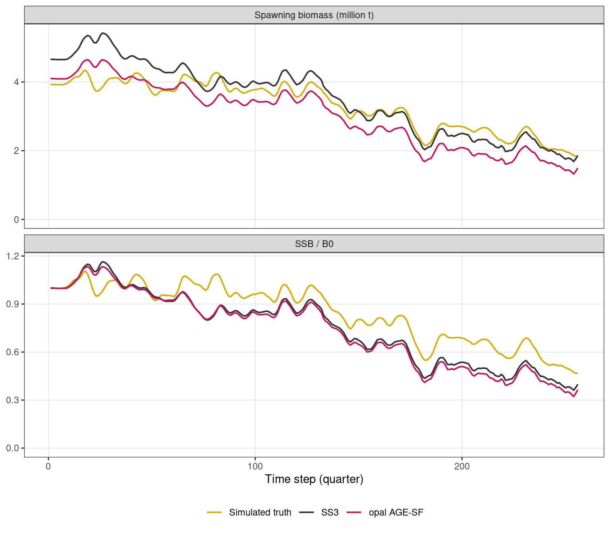
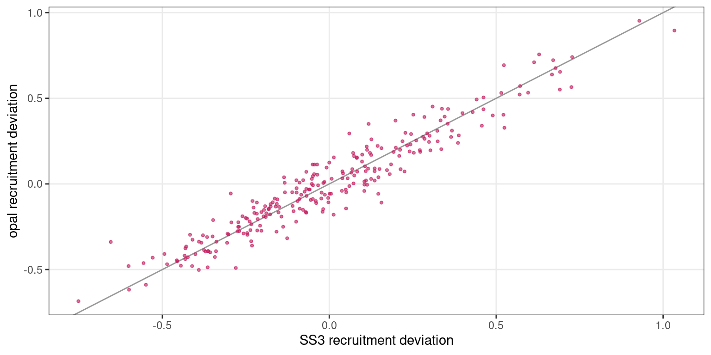
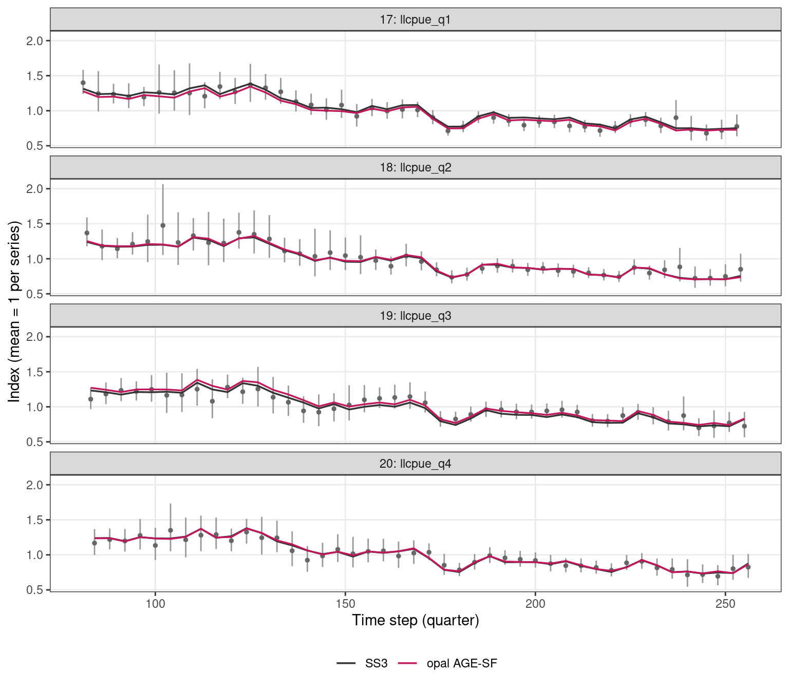
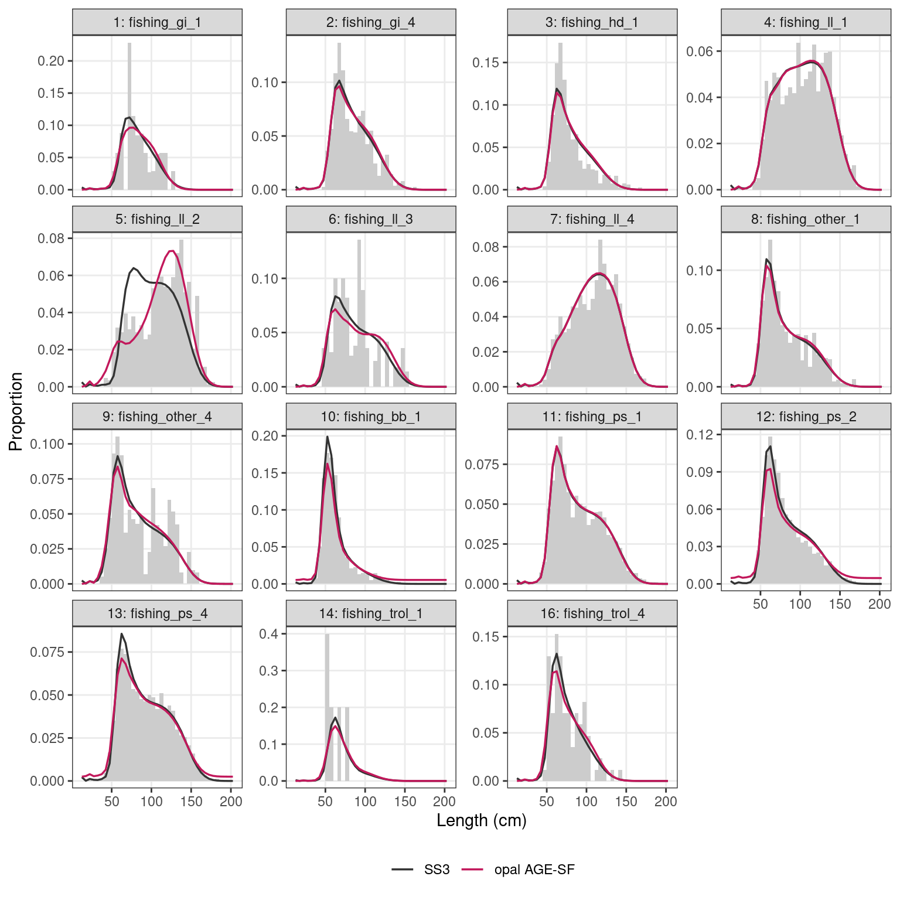
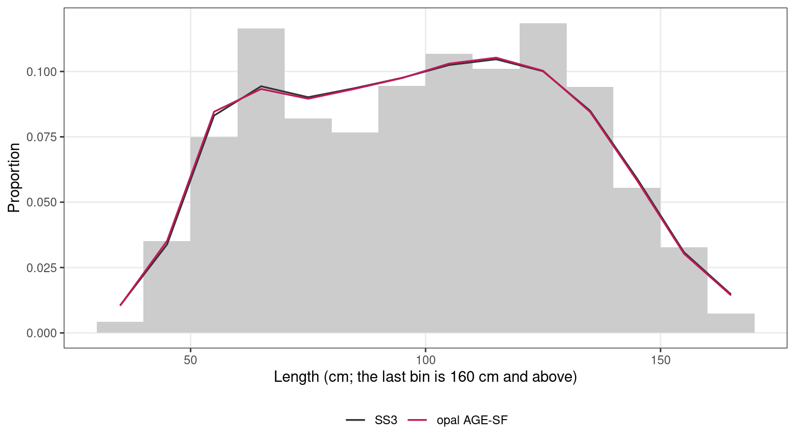
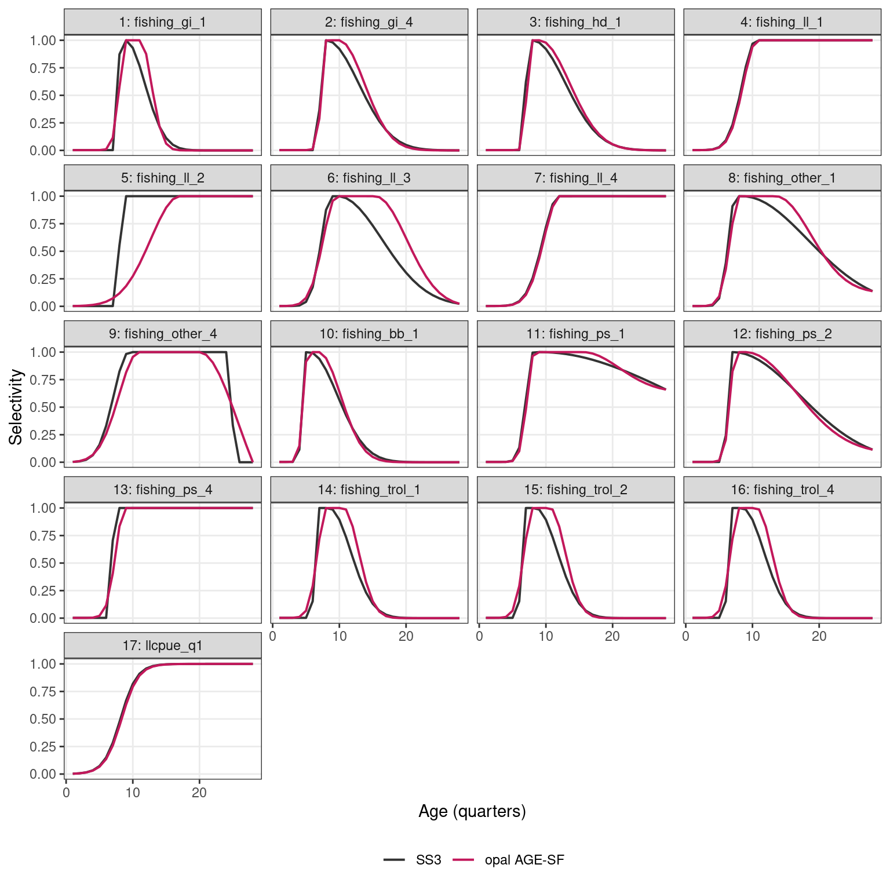

# Indian Ocean yellowfin tuna: Cross model comparison with simulated truth and Stock Synthesis estimation model

Setup

``` r

library(opal)
library(ggplot2)

data(io_yft_data)
data(io_yft_parameters)
data(io_yft_map)
data(io_yft_reference)

ref   <- io_yft_reference
d     <- io_yft_data
n_ts  <- d$n_year
truth <- ref$truth$trajectory
ss3   <- ref$ss3$trajectory
sf    <- ref$ss3$sizefreq

# Model outputs precomputed by data-raw/generate-io-yft-vignette-cache.R, so
# the article renders without rebuilding the RTMB model
cache <- readRDS(system.file("extdata", "io_yft_vignette_cache.rds", package = "opal"))
opal_m <- cache$models$age_sf

fmt <- function(x, digits = 2) formatC(x, format = "f", digits = digits, big.mark = ",")
options(knitr.kable.NA = "—")
fleet_name <- function(f) sprintf("%d: %s", as.integer(f), ref$fleet_names[as.integer(f)])
last <- function(df, v) df[[v]][df$ts == max(df$ts)]

series_col <- c("Simulated truth" = "#D4AC0D", "SS3" = "grey20", "opal AGE-SF" = "#C2185B")
scale_series <- list(scale_colour_manual(values = series_col, name = NULL, drop = TRUE))
theme_set(theme_bw(base_size = 11) +
            theme(legend.position = "bottom", panel.grid.minor = element_blank()))
```

This article compares three views of one simulated Indian Ocean
yellowfin tuna stock: the **simulated truth** from the spatial operating
model that generated the data, the **Stock Synthesis 3 (SS3)**
assessment of those data developed by the IATTC analyst team, and **opal
AGE-SF**, an opal model of the same data configured to match that SS3
model as closely as opal can while every estimated parameter stays
identified. How far opal AGE-SF is from SS3 measures how well opal
reproduces an established assessment; how far either is from the truth
measures how well a single-region assessment recovers a spatially
structured stock. The differences between opal and SS3 that remain after
matching their settings are described in [Table 1](#tbl-differences) and
[Table 2](#tbl-estimation).

Both the simulated data and the SS3 model come from the Spatial Stock
Assessment Simulation Experiment, an international, blinded experiment
in which analyst teams assessed data simulated from spatially explicit
operating models without knowing the truth ([Goethel et
al. 2024](https://doi.org/10.1111/faf.12819)). The IATTC team’s SS3
model was one of the assessments submitted to it.

Show code

``` r

n_catch <- sum(d$catch_obs_ysf > 0)
n_cpue  <- nrow(d$cpue_data)
n_lf    <- length(d$lf_year)
n_sf    <- length(unique(sf$data$ts))
n_comp_cells <- n_lf * d$n_len + n_sf * length(sf$bins)
```

The data are not a toy example. The model runs 256 quarterly time steps
(1952–2015) for 16 extraction fisheries. It is conditioned on 3,642
non-zero fishery-quarter catches and fits 176 longline CPUE observations
in four quarterly series, 1,114 length compositions over 39 bins of 5 cm
and 127 index size compositions over 14 bins: about 45,224 composition
cells in all. opal AGE-SF estimates 319 parameters, most of them the 256
quarterly recruitment deviations. This is comparable to the operational
IOTC yellowfin assessment the operating model was conditioned on ([Fu et
al. 2018](https://iotc.org/sites/default/files/documents/2018/10/IOTC-2018-WPTT20-33.pdf)),
which is also a quarterly, multi-fleet, age-structured Stock Synthesis
model fitted to catch, CPUE and length compositions over a similar
period.

Everything needed is bundled with the package: the data, SS3’s and the
operating model’s results, and the stored opal fit.

## The three models

### The simulated truth

The data are replicate 4 of the Indian Ocean yellowfin operating model
(OM) of the [Spatial Stock Assessment Simulation
Experiment](https://aaronmberger-nwfsc.github.io/Spatial-Assessment-Modeling-Workshop/articles/OM_description_YFT.html).
The OM was built in the Spatial Population Model software (SPM; Dunn,
Rasmussen and Mormede 2015) and conditioned on Indian Ocean Tuna
Commission (IOTC) fishery data ([Dunn, Hoyle and Datta
2020](https://iotc.org/sites/default/files/documents/2020/10/IOTC-2020-WPTT22AS-19_Rev1.pdf)).
The experiment and its results across all participating assessments are
described by [Goethel et al. (2024)](https://doi.org/10.1111/faf.12819).
The OM is spatially explicit:

- **Space and time.** The population lives on a 5° × 5° grid of 159
  ocean cells, in quarterly time steps from 1952 to 2015 (256 quarters),
  with ages 1–28 quarters (28 is a plus group).
- **Recruitment.** One stock with one Beverton–Holt stock–recruitment
  relationship (steepness 0.8) on the total spawning biomass. Quarterly
  recruitment strength varies (lognormal, SD 0.6), and each quarter’s
  recruits are spread across cells by a spatial apportionment layer with
  its own random variation.
- **Movement.** Fish move between cells every quarter according to
  habitat preferences for sea surface temperature, chlorophyll-a and
  distance, separately for immature and mature fish. Maturation moves
  fish from the immature to the mature state.
- **Fishing.** Seven gear-type fisheries remove their observed catches
  exactly, cell by cell, using exploitation rates.
- **Data.** Catch (without error), longline CPUE, length frequencies and
  tag recaptures are simulated cell by cell.

For the experiment, the simulated data were aggregated to the four
regions of the IOTC yellowfin assessment and to a single area. Because
the data are simulated, the true spawning biomass and unfished spawning
biomass (B0) are known. The truth files report them by assessment
region; here they are summed over the whole domain. Spawning biomass is
mature biomass at the start of the quarter, before fishing, in tonnes,
the same definition as SS3’s and opal’s.

### The SS3 model

The SS3 model (SS3 v3.24) is the IATTC analyst team’s single-region
estimation model for the experiment, built by Mark N. Maunder, Haikun Xu
and Carolina Minte-Vera. It treats each quarter as a model “year”, so it
runs 256 time steps. It keeps the four-region structure in its fleets:
its 16 extraction fisheries are gear × region combinations (for example,
`fishing_ll_1` to `fishing_ll_4` are longline in regions 1–4). Its mean
length-at-age is the OM’s own ([Fu et
al. 2018](https://iotc.org/sites/default/files/documents/2018/10/IOTC-2018-WPTT20-33.pdf),
after Fonteneau and Gascuel 2008), so growth is known exactly.
Selectivity is age-based, and the longline survey has both a CPUE index
and generalised size compositions.

### opal AGE-SF

The bundled opal inputs were produced from SS3’s data, control,
parameter and report files by an SS3-to-opal converter
([opal-sandbox](https://github.com/N-DucharmeBarth/opal-sandbox),
`code/rtmb`). They reconcile exactly with SS3 for catch, the index, the
length compositions and biology (M, weight, maturity and spawning
potential at age). opal takes the same time steps (`n_year =` 256,
`n_season = 1`) and SS3’s ages 1–28, so the opal age index equals the
SS3 age.

Show code

``` r

knitr::kable(data.frame(
  quantity = c("Time steps (quarters)", "Ages", "Extraction fisheries",
               "Index series (longline CPUE, one per quarter)",
               "Fisheries with length compositions", "Length bins",
               "Index size-composition bins"),
  value = c(n_ts, d$n_age, 16, 4, length(d$lf_fishery_f), d$n_len, length(sf$bins))),
  col.names = c("Quantity", "Value"))
```

| Quantity                                      | Value |
|:----------------------------------------------|------:|
| Time steps (quarters)                         |   256 |
| Ages                                          |    28 |
| Extraction fisheries                          |    16 |
| Index series (longline CPUE, one per quarter) |     4 |
| Fisheries with length compositions            |    15 |
| Length bins                                   |    39 |
| Index size-composition bins                   |    14 |

The bundled inputs (`io_yft_data`, `io_yft_parameters`, `io_yft_map`)
use opal’s default length-based selectivity. AGE-SF changes them in two
ways, shown in [Building AGE-SF](#building-age-sf): it uses SS3’s
age-based selectivity curves, and it fits SS3’s index size compositions
with SS3’s weight. Other differences between SS3 and opal stay, as
structural choices rather than settings to match.

### How the three differ

The population and fishing processes:

|  | Simulated truth (SPM) | SS3 | opal AGE-SF |
|----|----|----|----|
| Space | 159 cells, movement between them | One region; fleets keep the four regions | As SS3 |
| Recruitment | Beverton–Holt (h = 0.8) on total SSB; spatially apportioned | Beverton–Holt; deviations sum to zero; age-0 recruits at *t* | SS3’s steepness and σ_R; unconstrained deviations; age-1 recruits at *t* + 1 |
| Growth | The OM’s | `GrowthModel 3`, age-specific K (the OM’s growth) | The same, through [`get_growth()`](https://n-ducharmebarth-noaa.github.io/opal/dev/reference/get_growth.md) with `log_k_mult` |
| Fishing | Seven gear fisheries; exploitation rates by cell | 16 fisheries; hybrid F (Baranov), F and M act together through the quarter | 16 fisheries; the quarter’s catch is removed at the start, then M acts |

Table 1: Structural differences between the simulated truth, SS3 and
opal AGE-SF in the population and fishing processes.

The estimation choices, which only the two assessments have:

|  | SS3 | opal AGE-SF |
|----|----|----|
| Selectivity | Age-based double normal (fisheries), logistic (survey); mirrors | The same curve families and mirrors, on age (`sel_basis_f = 2`) |
| Selectivity bounds | Per parameter (index inflection 8–18 quarters) | ±20 on opal’s age scale for every `par_sel` |
| Timing of observations | Index and compositions at mid-quarter | Everything at the start of the quarter |
| Index | One series, one analytic catchability | Four quarterly series, four estimated catchabilities |
| Index size compositions | 14 bins from 30 cm, λ = 0.51 | The same bins and λ |
| Priors | None (λ = 0 on parameter priors) | opal’s defaults: N(0, 2) on `par_sel`, weak normal priors on log B0 and log q |
| Equilibrium plus group | Iterated to 3 × the number of ages | Closed-form geometric tail (≈5e-5 difference in SPR0) |

Table 2: Differences in estimation choices between SS3 and opal AGE-SF.

Catch timing is the largest difference. At SS3’s own parameter values,
it alone moves opal’s spawning biomass by up to 10%, because under heavy
catch opal ends each quarter with more fish than the Baranov equation
leaves. The priors are kept on purpose (see [How we got
here](#how-we-got-here)).

## Building AGE-SF

### Growth

The bundled inputs already use SS3’s age-specific K growth. (The first
conversion used opal’s single-k Schnute curve, which was 5–16 cm too
long at ages 4–8 and moved the fitted stock size well away from SS3’s;
opal now implements `GrowthModel 3` through
[`get_growth()`](https://n-ducharmebarth-noaa.github.io/opal/dev/reference/get_growth.md).)

Show code

``` r

p <- io_yft_parameters
laa_opal <- get_growth(d$n_age, d$A1, d$A2, exp(p$log_L1), exp(p$log_L2), p$log_k,
                       min_age = d$min_age, log_k_mult = p$log_k_mult,
                       k_mult_ages = d$k_mult_ages,
                       plus_group_adjust = isTRUE(d$growth_plus_group_adjust))
```

opal’s mean length-at-age differs from SS3’s by at most 0.0005 cm.

### Age-based selectivity

SS3 uses double normal curves (`age_selex` pattern 20) for the
fisheries, mirrors (pattern 15) for fisheries 15 and 16, and a logistic
curve (pattern 12) for the longline index. `sel_basis_f = 2` evaluates
opal’s curves directly on age, and
`convert_ss3_selex_to_rtmb(basis = "age")` converts SS3’s estimated
parameters, held in `io_yft_reference`, to opal’s `par_sel` scale:

Show code

``` r

sp  <- ref$ss3$sel_par
pat <- ref$ss3$sel_pattern

# SS3 fleet whose parameters each opal fishery uses: fisheries 1-16 are SS3
# fleets 1-16 (15 and 16 mirror 14 through pattern 15), and the four
# quarterly index series 17-20 are SS3's survey, fleet 17.
ss3_fleet <- c(seq_len(16), rep(17L, 4))
mirror <- pat$pattern[ss3_fleet] == 15L
ss3_fleet[mirror] <- pat$special[ss3_fleet[mirror]]
ss3_pars <- t(vapply(ss3_fleet, function(fl) {
  v <- sp$value[sp$fleet == fl]
  c(v, rep(0, 6 - length(v)))
}, numeric(6)))

d_age <- io_yft_data
d_age$sel_basis_f <- rep(2L, d_age$n_fishery)
p_age <- io_yft_parameters
p_age$par_sel <- convert_ss3_selex_to_rtmb(ss3_pars, d_age$sel_type_f,
                                           sel_lengths = d_age$len_mid,
                                           basis = "age", sel_ages = d_age$age_a)
```

SS3’s final selectivity is −999 for every double normal, meaning “no
adjustment”: the descending limb is the plain normal curve.
[`convert_ss3_selex_to_rtmb()`](https://n-ducharmebarth-noaa.github.io/opal/dev/reference/convert_ss3_selex_to_rtmb.md)
turns −999 into −9, which pulls the whole limb down. Setting the final
selectivity to the unadjusted curve’s own value at the oldest age
reproduces “no adjustment” exactly at the starting values (the final
selectivity is fixed, so this is an approximation once the peak or
descending width move):

Show code

``` r

# Unadjusted descending limb at the oldest age, as in sel_double_normal()
dn_unadjusted_end <- function(par, x) {
  n <- length(x)
  bin_width <- x[2] - x[1]
  peak <- mean(x) + par[1] * sd(x)
  peak2 <- peak + bin_width + (0.99 * x[n] - peak - bin_width) / (1 + exp(-par[2]))
  exp(-(x[n] - peak2)^2 / (exp(par[4]) * sd(x)^2))
}
for (f in which(d_age$sel_type_f == 2L & ss3_pars[, 6] <= -999)) {
  p_age$par_sel[f, 6] <- max(qlogis(dn_unadjusted_end(p_age$par_sel[f, ], d_age$age_a)), -20)
}
```

The map estimates every selectivity parameter SS3 estimated (phase \>
0), with SS3’s mirrors. On the age scale, SS3’s plateau and
ascending-width parameters for several fisheries are near −10 to −15,
outside opal’s default `par_sel` bounds of ±7, so the bounds are widened
to SS3’s ±20:

Show code

``` r

est <- matrix(NA_integer_, d_age$n_fishery, 6)
k <- 0L
for (fl in unique(ss3_fleet)) {
  cols <- sp$par[sp$fleet == fl & sp$phase > 0]
  ids <- k + seq_along(cols)
  k <- k + length(cols)
  for (f in which(ss3_fleet == fl)) est[f, cols] <- ids
}
map_age <- io_yft_map
map_age$par_sel <- factor(as.vector(est))

age_bounds <- function(parameters, map, lim = 20) {
  active <- unlist(lapply(names(parameters), function(n)
    rep(n, if (is.null(map[[n]])) length(parameters[[n]]) else nlevels(droplevels(map[[n]])))))
  b <- get_bounds(list(par = setNames(numeric(length(active)), active)), parameters)
  b$lower[b$parameter == "par_sel"] <- -lim
  b$upper[b$parameter == "par_sel"] <- lim
  b
}
```

At SS3’s parameters, opal’s age-based curves reproduce SS3’s
selectivity-at-age:

Show code

``` r

sel0 <- get_selectivity(d_age, p_age$par_sel, pla = NULL, len_mid = d_age$len_mid,
                        age_a = d_age$age_a)[, 1, ]
s0 <- data.frame(fishery = rep(seq_len(nrow(sel0)), times = ncol(sel0)),
                 age = rep(d_age$age_a, each = nrow(sel0)), sel = as.vector(sel0))
cmp <- merge(s0, ref$ss3$sel_age, by = c("fishery", "age"), suffixes = c("_opal", "_ss3"))
```

The largest difference over all fisheries and ages is 0.0010; 58
selectivity parameters are estimated.

### Index size compositions

SS3’s generalised size compositions for the survey use 14 bins with
lower edges 30, 40, 50, 60, 70, 80, 90, 100, 110, 120, 130, 140, 150,
160 cm, in numbers, with 127 observations and sample sizes of 5–35. SS3
puts the population below 30 cm into the first bin, and the last bin is
open-ended; opal’s default `"accumulate"` tails do both.
[`prep_lf_data()`](https://n-ducharmebarth-noaa.github.io/opal/dev/reference/prep_lf_data.md)
takes the 5 cm length compositions and the size compositions as two wide
tables, each on its own bins; only opal’s predictions are rebinned. In
opal the index is four quarterly series, so each observation goes to the
index fishery of its quarter; the four share one selectivity curve, as
SS3’s survey does. SS3’s lambda of 0.51 on the size compositions becomes
an `lf` lambda on those four fisheries.

Show code

``` r

# The bundled 5 cm compositions as a wide table of counts. lf_n carries
# SS3's variance adjustment (n / lf_var_adjust), so it is undone here for
# prep_lf_data() to reapply.
lf_wide <- function(d) {
  n_raw <- d$lf_n * d$lf_var_adjust[d$lf_fishery]
  counts <- d$lf_obs_in * n_raw
  colnames(counts) <- as.character(d$len_lower)
  data.frame(fishery = d$lf_fishery, year = d$lf_year, month = 1L, ts = d$lf_year,
             counts, check.names = FALSE)
}
# SS3's size compositions as a wide table of counts (proportion x sample size)
sizefreq_wide <- function(ref) {
  sf <- ref$ss3$sizefreq$data
  wide <- stats::reshape(sf[, c("ts", "fishery", "nsamp", "bin", "obs")],
                         idvar = c("ts", "fishery", "nsamp"), timevar = "bin",
                         direction = "wide")
  counts <- as.matrix(wide[, paste0("obs.", ref$ss3$sizefreq$bins)]) * wide$nsamp
  colnames(counts) <- as.character(ref$ss3$sizefreq$bins)
  data.frame(fishery = wide$fishery, year = wide$ts, month = 1L, ts = wide$ts,
             counts, check.names = FALSE, row.names = NULL)
}

# Both bin schemes end at the top of the model's length grid
top <- d_age$len_bin_start + d_age$n_len * d_age$len_bin_width
d_sf <- prep_lf_data(
  d_age,
  list(lf_wide(d_age), sizefreq_wide(ref)),
  lf_switch     = d_age$lf_switch,
  lf_minbin     = d_age$lf_minbin,
  lf_maxbin     = d_age$lf_maxbin,
  lf_var_adjust = d_age$lf_var_adjust,
  lf_addtocomp  = d_age$lf_addtocomp,
  lf_upper_edge = c(top, top))

index_f <- sort(unique(d_age$cpue_data$fishery))
lf_lambda <- rep(1, d_sf$n_fishery)
lf_lambda[index_f] <- sf$lambda
d_sf$lambdas <- list(lf = lf_lambda)
```

At SS3’s solution (before fitting), opal’s predicted size compositions
are close to SS3’s expected values:

Show code

``` r

ss3_like <- function(o, e, n) { i <- o > 0; -sum(n[i] * o[i] * log(e[i] / o[i])) }
sf_pred <- function(nm) merge(sf$data, cache$models[[nm]]$sizefreq,
                              by = c("fishery", "ts", "bin"))
chk <- sf_pred("age_sf_start")
knitr::kable(data.frame(
  quantity = c("Largest difference in a proportion", "Mean absolute difference",
               "SS3-style multinomial likelihood, SS3's expected values",
               "The same, opal's predictions", "SS3's reported likelihood (Report.sso)"),
  value = c(fmt(max(abs(chk$predicted - chk$expected)), 4),
            fmt(mean(abs(chk$predicted - chk$expected)), 4),
            fmt(ss3_like(chk$obs, chk$expected, chk$nsamp), 1),
            fmt(ss3_like(chk$obs, chk$predicted, chk$nsamp), 1), "1,067.4")),
  col.names = c("At SS3's solution", "Value"))
```

| At SS3’s solution                                       | Value   |
|:--------------------------------------------------------|:--------|
| Largest difference in a proportion                      | 0.0102  |
| Mean absolute difference                                | 0.0014  |
| SS3-style multinomial likelihood, SS3’s expected values | 1,067.5 |
| The same, opal’s predictions                            | 1,064.0 |
| SS3’s reported likelihood (Report.sso)                  | 1,067.4 |

The remaining difference is the timing: SS3 takes the survey at
mid-quarter, opal at the start. (The SS3-style likelihood is −Σ N o
log(e / o); opal’s multinomial differs by a constant.)

## Fit

AGE-SF is fitted in two steps: first without the size compositions
(AGE), from SS3’s solution, then with them, from AGE’s estimates.
Fitting takes several minutes, so the article uses the stored fit, made
from exactly these inputs. `data-raw/generate-io-yft-fits.R` also
polishes the optimum with Newton steps and runs
[`opal_check()`](https://n-ducharmebarth-noaa.github.io/opal/dev/reference/opal_check.md)
with a gradient tolerance of 1e-4.

Show code

``` r

control <- list(eval.max = 10000, iter.max = 10000)
age <- opal_fit(opal_obj(d_age, p_age, map_age, bounds = age_bounds(p_age, map_age),
                         control = control), n_passes = 2L)
p_start <- opal_rtmb(age)$env$parList(age$fit$opt$par)
age_sf <- opal_fit(opal_obj(d_sf, p_start, map_age, bounds = age_bounds(p_start, map_age),
                            control = control), n_passes = 2L)

# The stored fit
age_sf <- opal_read(system.file("extdata", "io_yft_age_sf_fit.rds", package = "opal"))
summary(age_sf)
```

Show code

``` r

v <- opal_m$fit
w <- opal_m$nll_w
knitr::kable(data.frame(
  quantity = c("Estimated parameters", "Objective", "Index", "Length compositions",
               "Index size compositions (× 0.51)", "Recruitment", "Priors",
               "Max |gradient|", "opal_check()"),
  value = c(v$n_par, fmt(v$objective, 2), fmt(w[["index"]], 1), fmt(w[["length"]], 1),
            fmt(w[["sizefreq"]], 1), fmt(w[["recruitment"]], 1), fmt(w[["prior"]], 1),
            formatC(v$max_gradient, format = "e", digits = 1),
            if (isTRUE(v$passes)) "passed" else "failed")),
  col.names = c("AGE-SF", "Value"))
```

| AGE-SF                           | Value     |
|:---------------------------------|:----------|
| Estimated parameters             | 319       |
| Objective                        | 15,601.99 |
| Index                            | -237.1    |
| Length compositions              | 14,231.6  |
| Index size compositions (× 0.51) | 969.2     |
| Recruitment                      | 136.1     |
| Priors                           | 679.4     |
| Max \|gradient\|                 | 7.0e-12   |
| opal_check()                     | passed    |

## How we got here

AGE-SF is the last of a sequence of opal fits, each making one change
from the one before. `SS3-SEL` holds selectivity at SS3’s estimates;
`LEN` is the bundled inputs (`io_yft_map`), with opal’s length-based
selectivity estimated; `AGE-SF-NP` is SS3’s configuration exactly, with
the priors switched off as well.

Show code

``` r

br <- cache$bridge
h <- ref$history[2, ]
bridge <- rbind(
  data.frame(model = "SS3-SEL", change = "SS3's selectivity held fixed",
             sel_free = 0L, B0 = h$B0, dep = h$terminal_depletion, check = NA),
  data.frame(model = br$model, change = br$change, sel_free = br$sel_free, B0 = br$B0,
             dep = br$terminal_depletion,
             check = ifelse(br$passes, "passed",
                            ifelse(br$positive_hessian, "failed", "failed (Hessian)"))),
  data.frame(model = "SS3", change = NA, sel_free = NA, B0 = ref$ss3$ssb0,
             dep = last(ss3, "static_dep"), check = NA),
  data.frame(model = "Simulated truth", change = NA, sel_free = NA, B0 = ref$truth$b0,
             dep = last(truth, "static_dep"), check = NA))
bridge$B0 <- bridge$B0 / ref$ss3$ssb0
bridge$model[bridge$model == "AGE-SF"] <- "**AGE-SF**"
knitr::kable(bridge, digits = c(0, 0, 0, 2, 3, 0), row.names = FALSE,
             col.names = c("Fit", "Change from the row above", "Selectivity parameters",
                           "B0 / SS3 B0", "Terminal SSB / B0", "opal_check()"))
```

| Fit | Change from the row above | Selectivity parameters | B0 / SS3 B0 | Terminal SSB / B0 | opal_check() |
|:---|:---|---:|---:|---:|:---|
| SS3-SEL | SS3’s selectivity held fixed | 0 | 1.03 | 0.404 | — |
| LEN | Estimate opal’s length-based selectivity | 49 | 0.88 | 0.307 | passed |
| AGE | SS3’s age-based curves and mirrors; every parameter SS3 estimated | 58 | 0.84 | 0.298 | passed |
| **AGE-SF** | Add SS3’s index size compositions (lambda 0.51) | 58 | 0.88 | 0.364 | passed |
| AGE-SF-NP | Switch off the priors (SS3’s lambda of 0) | 38 | 0.91 | 0.374 | failed (Hessian) |
| SS3 | — | — | 1.00 | 0.399 | — |
| Simulated truth | — | — | 0.84 | 0.468 | — |

Show code

``` r

b <- setNames(seq_len(nrow(br)), br$model)
```

- Held at SS3’s selectivity, opal reproduces SS3’s stock size closely.
  Estimating selectivity lowers it, whether the curves are opal’s
  length-based ones (LEN) or SS3’s own age-based ones (AGE), so the
  selectivity basis is not what separates opal from SS3.
- The index size compositions inform the index’s selectivity, which
  otherwise only the CPUE trend informs. They move opal’s depletion from
  0.298 to 0.364, towards SS3’s.
- Switching off the priors, as SS3 does, leaves 20 selectivity
  parameters with a flat likelihood (plateau widths at a single age,
  knife-edge limbs, and the plateau and descending limb of asymptotic
  fisheries). AGE-SF-NP holds them fixed, and its Hessian is still not
  positive definite, so its standard errors cannot be used; SS3, run
  without a Hessian, does not report on this. Its stock status differs
  little from AGE-SF’s. Without priors the likelihood also has more than
  one optimum: started from SS3’s solution rather than AGE’s estimates,
  AGE-SF-NP stops at a worse optimum with a larger stock. AGE-SF keeps
  opal’s priors, which identify every parameter SS3 estimated.

## Stock status

Show code

``` r

traj <- rbind(
  data.frame(truth, series = "Simulated truth"),
  data.frame(ss3, series = "SS3"),
  data.frame(opal_m$trajectory, series = "opal AGE-SF"))
traj$series <- factor(traj$series, names(series_col))
long <- rbind(data.frame(ts = traj$ts, series = traj$series, value = traj$ssb / 1e6,
                         panel = "Spawning biomass (million t)"),
              data.frame(ts = traj$ts, series = traj$series, value = traj$static_dep,
                         panel = "SSB / B0"))
ggplot(long, aes(ts, value, colour = series)) +
  geom_line(linewidth = 0.7) +
  facet_wrap(~ panel, ncol = 1, scales = "free_y") +
  expand_limits(y = 0) +
  scale_series +
  labs(x = "Time step (quarter)", y = NULL)
```



Spawning biomass (top) and static depletion SSB / B0 (bottom): the
simulated truth, SS3 and opal AGE-SF.

Show code

``` r

compare <- function(x, y) {
  m <- merge(x, y, by = "ts")
  c(mean_pct = mean(abs(100 * (m$ssb.x / m$ssb.y - 1))),
    max_dep = max(abs(m$static_dep.x - m$static_dep.y)))
}
opal_tr <- opal_m$trajectory
B0 <- c(ref$truth$b0, ref$ss3$ssb0, opal_m$B0)
tab <- data.frame(
  model = names(series_col),
  B0 = B0 / 1e6,
  B0_truth = B0 / ref$truth$b0,
  terminal = c(last(truth, "static_dep"), last(ss3, "static_dep"),
               last(opal_tr, "static_dep")),
  pct_truth = c(NA, compare(ss3, truth)[["mean_pct"]], compare(opal_tr, truth)[["mean_pct"]]),
  dep_truth = c(NA, compare(ss3, truth)[["max_dep"]], compare(opal_tr, truth)[["max_dep"]]),
  pct_ss3 = c(NA, NA, compare(opal_tr, ss3)[["mean_pct"]]),
  dep_ss3 = c(NA, NA, compare(opal_tr, ss3)[["max_dep"]]))
knitr::kable(tab, digits = c(0, 2, 2, 3, 1, 3, 1, 3), row.names = FALSE,
             col.names = c("Model", "B0 (million t)", "B0 / true B0", "Terminal SSB / B0",
                           "SSB mean |% diff| from truth", "Max |depletion diff| from truth",
                           "SSB mean |% diff| from SS3", "Max |depletion diff| from SS3"))
```

| Model | B0 (million t) | B0 / true B0 | Terminal SSB / B0 | SSB mean \|% diff\| from truth | Max \|depletion diff\| from truth | SSB mean \|% diff\| from SS3 | Max \|depletion diff\| from SS3 |
|:---|---:|---:|---:|---:|---:|---:|---:|
| Simulated truth | 3.93 | 1.00 | 0.468 | — | — | — | — |
| SS3 | 4.66 | 1.19 | 0.399 | 9.8 | 0.252 | — | — |
| opal AGE-SF | 4.10 | 1.04 | 0.364 | 13.7 | 0.244 | 14.6 | 0.039 |

Show code

``` r

rd <- merge(data.frame(ts = seq_along(opal_m$rdev), opal = opal_m$rdev),
            ref$ss3$recdevs, by = "ts")
ggplot(rd, aes(recdev, opal)) +
  geom_abline(colour = "grey60") +
  geom_point(size = 0.8, alpha = 0.6, colour = series_col[["opal AGE-SF"]]) +
  labs(x = "SS3 recruitment deviation", y = "opal recruitment deviation")
```



Recruitment deviations, opal AGE-SF against SS3. opal’s deviation for
time step t sets the age-1 recruits entering at t + 1. The truth’s
recruitment is not part of the bundled reference values.

## Fits to the data

The truth has no fits to the data, and its selectivity is defined by
gear and cell, so this section compares SS3 and opal only.

### Index

Show code

``` r

cp <- d$cpue_data
idx <- data.frame(ts = cp$ts, fishery = cp$fishery, obs = cp$value, se = cp$se,
                  pred = opal_m$cpue$pred)
pred <- rbind(data.frame(ts = ref$ss3$cpue$ts, fishery = ref$ss3$cpue$fishery,
                         value = ref$ss3$cpue$expected, series = "SS3"),
              data.frame(ts = idx$ts, fishery = idx$fishery, value = idx$pred,
                         series = "opal AGE-SF"))
pred$series <- factor(pred$series, names(series_col))
ggplot() +
  geom_linerange(data = idx, aes(ts, ymin = obs * exp(-1.96 * se), ymax = obs * exp(1.96 * se)),
                 colour = "grey60") +
  geom_point(data = idx, aes(ts, obs), size = 1, colour = "grey40") +
  geom_line(data = pred, aes(ts, value, colour = series), linewidth = 0.6) +
  facet_wrap(~ fishery, ncol = 1, labeller = as_labeller(fleet_name)) +
  scale_series +
  labs(x = "Time step (quarter)", y = "Index (mean = 1 per series)")
```



Observed longline index (points, ±1.96 SE) with SS3’s expected values
and opal’s predictions. Each quarterly series is on a mean-one scale.

Show code

``` r

rmse <- function(o, p) sqrt(mean((log(o) - log(p))^2))
knitr::kable(data.frame(model = c("SS3", "opal AGE-SF"),
                        rmse = c(rmse(ref$ss3$cpue$obs, ref$ss3$cpue$expected),
                                 rmse(idx$obs, idx$pred))),
             digits = 4, col.names = c("Model", "RMSE of log index residuals"))
```

| Model       | RMSE of log index residuals |
|:------------|----------------------------:|
| SS3         |                      0.0646 |
| opal AGE-SF |                      0.0642 |

### Length compositions

Show code

``` r

agg <- do.call(rbind, lapply(seq_along(d$lf_fishery_f), function(j) {
  obs <- d$lf_obs_data$obs[[j]]
  obs <- obs / rowSums(obs)
  n   <- d$lf_n_fi[[j]]
  data.frame(fishery = d$lf_fishery_f[j], bin = d$len_lower,
             observed = colSums(obs * n) / sum(n))
}))
lines <- rbind(
  data.frame(fishery = ref$ss3$lf$fishery, bin = ref$ss3$lf$bin,
             value = ref$ss3$lf$expected, series = "SS3"),
  data.frame(fishery = opal_m$lf$fishery, bin = opal_m$lf$bin,
             value = opal_m$lf$predicted, series = "opal AGE-SF"))
lines$series <- factor(lines$series, names(series_col))
width <- diff(d$len_lower[1:2])
ggplot() +
  geom_col(data = agg, aes(bin + width / 2, observed), fill = "grey80", width = width) +
  geom_line(data = lines, aes(bin + width / 2, value, colour = series), linewidth = 0.6) +
  facet_wrap(~ fishery, ncol = 4, scales = "free_y", labeller = as_labeller(fleet_name)) +
  scale_series +
  labs(x = "Length (cm)", y = "Proportion")
```



Length compositions aggregated over all observations for each fishery,
weighted by sample size: observed (bars), SS3’s expected values and
opal’s predictions.

### Index size compositions

Show code

``` r

agg_sf <- function(p, v) {
  a <- tapply(p[[v]] * p$nsamp, p$bin, sum)
  data.frame(bin = as.numeric(names(a)), value = as.numeric(a / sum(a)))
}
p_sf <- sf_pred("age_sf")
lines_sf <- rbind(data.frame(agg_sf(p_sf, "expected"), series = "SS3"),
                  data.frame(agg_sf(p_sf, "predicted"), series = "opal AGE-SF"))
lines_sf$series <- factor(lines_sf$series, names(series_col))
ggplot() +
  geom_col(data = agg_sf(p_sf, "obs"), aes(bin + 5, value), fill = "grey80", width = 10) +
  geom_line(data = lines_sf, aes(bin + 5, value, colour = series), linewidth = 0.6) +
  scale_series +
  labs(x = "Length (cm; the last bin is 160 cm and above)", y = "Proportion")
```



Index size compositions aggregated over all observations, weighted by
sample size: observed (bars), SS3’s expected values and opal’s
predictions.

Show code

``` r

knitr::kable(data.frame(
  model = c("SS3", "opal AGE-SF"),
  like = c(ss3_like(p_sf$obs, p_sf$expected, p_sf$nsamp),
           ss3_like(p_sf$obs, p_sf$predicted, p_sf$nsamp))),
  digits = 1, col.names = c("Model", "SS3-style likelihood of the index size compositions"))
```

| Model       | SS3-style likelihood of the index size compositions |
|:------------|----------------------------------------------------:|
| SS3         |                                              1067.5 |
| opal AGE-SF |                                              1067.7 |

### Selectivity

Show code

``` r

sa <- rbind(data.frame(ref$ss3$sel_age, series = "SS3"),
            data.frame(opal_m$sel_age, series = "opal AGE-SF"))
sa$series <- factor(sa$series, names(series_col))
ggplot(sa[sa$fishery <= 17, ], aes(age, sel, colour = series)) +
  geom_line(linewidth = 0.7) +
  facet_wrap(~ fishery, ncol = 4, labeller = as_labeller(fleet_name)) +
  scale_series +
  labs(x = "Age (quarters)", y = "Selectivity")
```



Selectivity-at-age: SS3 and opal AGE-SF.

Show code

``` r

a50 <- function(sa) {
  s <- sa[sa$fishery == 17, ]
  stats::approx(s$sel, s$age, 0.5, ties = "ordered")$y
}
a50_ss3 <- a50(ref$ss3$sel_age)
a50_opal <- a50(opal_m$sel_age)
```

Fisheries 15 and 16 mirror 14, and panel 17 stands for all four
quarterly index series. The index reaches 50% selectivity at 8.3
quarters in opal and 8.1 in SS3; SS3’s estimate sits at its lower bound
of 8 quarters, which opal does not impose.

## Summary

Show code

``` r

dep_t <- last(truth, "static_dep")
dep_s <- last(ss3, "static_dep")
dep_o <- last(opal_tr, "static_dep")
```

- **Against the truth.** Neither single-region assessment is the truth.
  The operating model has movement among 159 cells and spatially varying
  recruitment, which neither represents. SS3’s B0 is 1.19 × the true B0
  and opal AGE-SF’s 1.04 ×; terminal depletion is 0.399 (SS3) and 0.364
  (opal), against a true 0.468.
- **Against SS3.** With SS3’s growth, selectivity curves and mirrors,
  index size compositions and lambda, opal AGE-SF’s B0 is 0.88 × SS3’s,
  and its spawning biomass differs from SS3’s by 14.6% on average. The
  fit converges and passes
  [`opal_check()`](https://n-ducharmebarth-noaa.github.io/opal/dev/reference/opal_check.md).
- **What remains.** The rest of the gap to SS3 lies in the structural
  differences that stay: catch removed at the start of the quarter
  rather than through it (up to 10% of spawning biomass at SS3’s own
  parameters), four quarterly catchabilities rather than one, and
  unconstrained recruitment deviations. It also depends on which optimum
  each model is in. Removing opal’s priors as well (AGE-SF-NP, SS3’s
  configuration) changes the stock status little, but leaves some
  selectivity parameters unidentified.

## Credit and references

The simulated example and the SS3 estimation model both come from the
Spatial Stock Assessment Simulation Experiment. The SS3 model was
developed by the IATTC analyst team (Mark N. Maunder, Haikun Xu and
Carolina Minte-Vera, Inter-American Tropical Tuna Commission) as their
submission to it. The experiment’s design, its operating models and the
evaluation of the submitted assessments, including theirs, are described
in:

- Goethel, D.R., et al. (2024). ‘Drivin’ with your eyes closed’: Results
  from an international, blinded simulation experiment to evaluate
  spatial stock assessments. *Fish and Fisheries* 25(3): 471–490.
  <https://doi.org/10.1111/faf.12819>

The age-specific K growth model is Stock Synthesis’ `GrowthModel 3`:

- Methot, R.D. Jr., and Wetzel, C.R. (2013). Stock synthesis: A
  biological and statistical framework for fish stock assessment and
  fishery management. *Fisheries Research* 142: 86–99.
  <https://doi.org/10.1016/j.fishres.2012.10.012>

The data and the simulated truth are from replicate 4 of the Indian
Ocean yellowfin operating model
(<https://github.com/aaronmberger-nwfsc/Spatial-Assessment-Modeling-Workshop>).
The IOTC working-party papers below have no DOI, so they link to the
IOTC document archive where a copy is available:

- Dunn, A., Rasmussen, S. and Mormede, S. (2015). Spatial Population
  Model. NIWA Technical Report 138.
- Dunn, A., Hoyle, S. and Datta, S. (2020). Development of spatially
  explicit operating models for yellowfin tuna populations in the Indian
  Ocean. IOTC-2020-WPTT22(AS)-19_Rev1.
  <https://iotc.org/sites/default/files/documents/2020/10/IOTC-2020-WPTT22AS-19_Rev1.pdf>
- Fu, D., Langley, A., Merino, G. and Urtizberea, A. (2018). Preliminary
  Indian Ocean yellowfin tuna stock assessment 1950–2017 (Stock
  Synthesis). IOTC-2018-WPTT20-33.
  <https://iotc.org/sites/default/files/documents/2018/10/IOTC-2018-WPTT20-33.pdf>
- Fonteneau, A. and Gascuel, D. (2008). Growth rates and apparent growth
  curves, for yellowfin, skipjack and bigeye tagged and recovered in the
  Indian Ocean during the IOTTP. IOTC-2008-WPTDA-08.

The SS3-to-opal converter is in
<https://github.com/N-DucharmeBarth/opal-sandbox> (`code/rtmb`); the
bundled data were exported by
code/rtmb/scripts/04-export-io-yft-for-opal.r at commit 047af02, and
SS3’s size compositions and lambdas by
code/rtmb/scripts/06-export-io-yft-sizefreq-for-opal.r. The opal outputs
shown were computed with opal 0.1.1 (commit fdcd449) by
`data-raw/generate-io-yft-fits.R` and
`data-raw/generate-io-yft-vignette-cache.R`.
